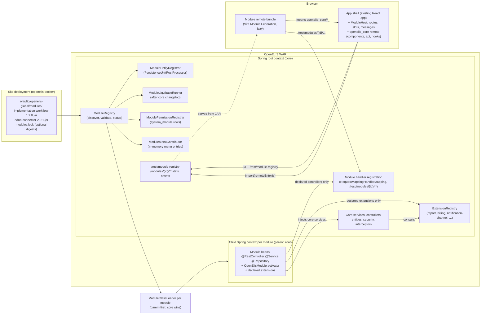
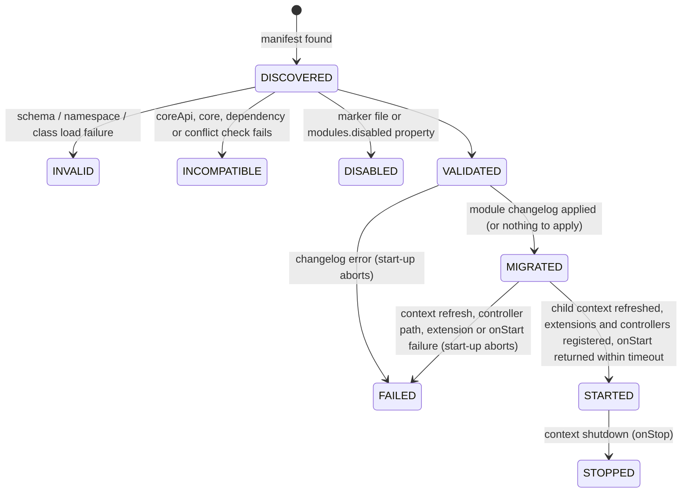
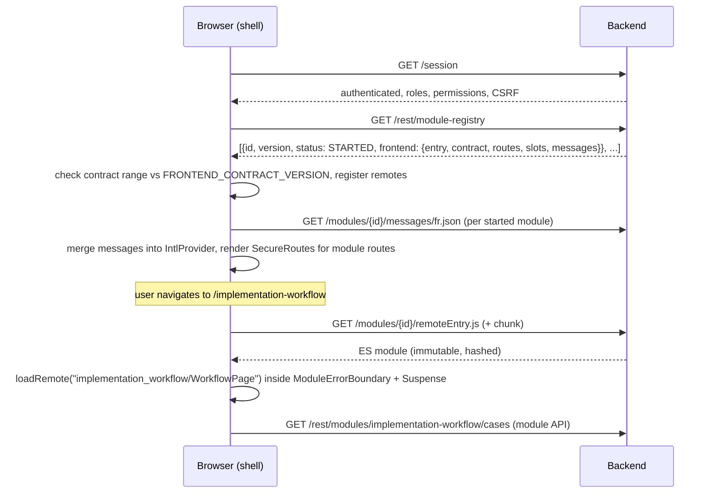
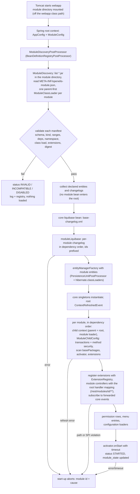
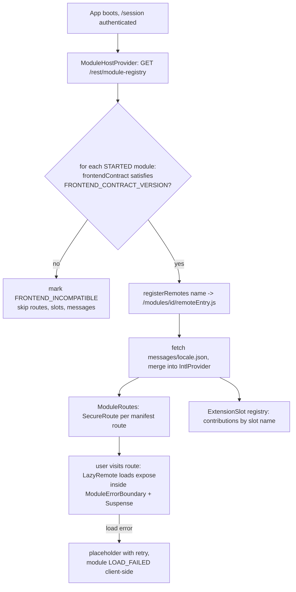
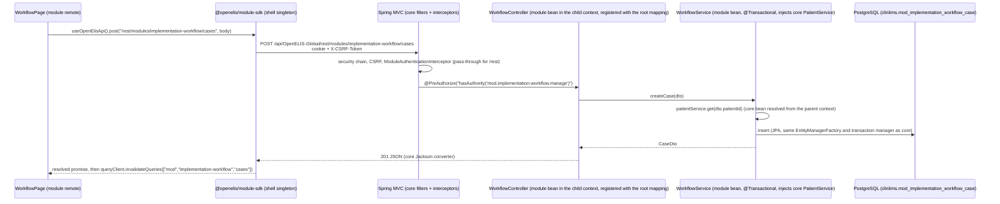
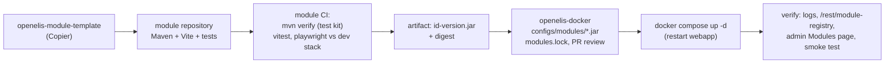
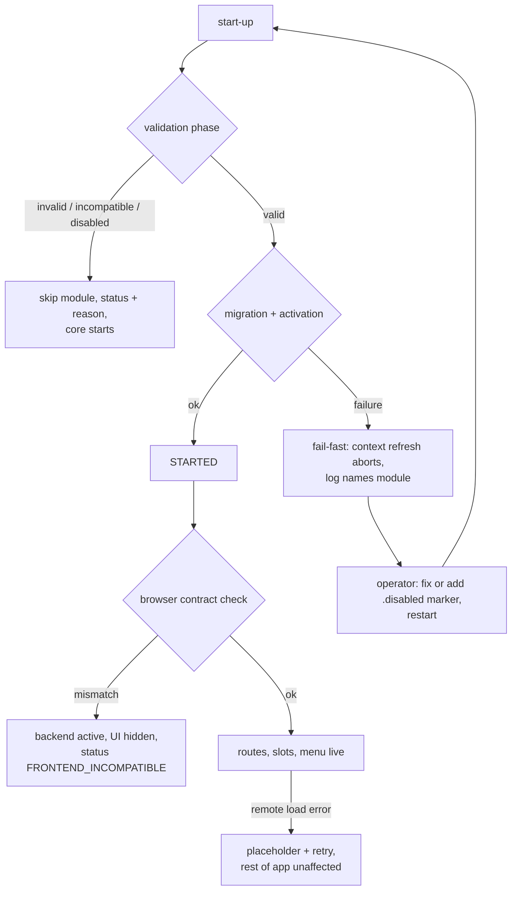

# OpenELIS Global Module System: Architecture Research and Design

| | |
|---|---|
| Status | Draft for review. Research and design only; nothing in this document is implemented. |
| Date | 2026-10-28 |
| Core revision studied | `develop` at `5f2808b02d` (pom `revision` 3.4.0-SNAPSHOT) |
| Audience | OpenELIS core maintainers, implementation teams, DIGI architecture review |
| Companion Jira | the epic created with this document (see "Roadmap") |
| Revision | 2026-10-29: reconciled with the companion *OpenELIS Modularization Plan: Comparing Architecture Models* (internal review, 2026-10-28); extension-point providers, per-module Spring contexts, core-dependency access for modules (backend and frontend), internal boundary checks and the decision checks added |

Evidence markers used throughout:

- **[confirmed]**: read in the source tree at the revision above, with the path cited.
- **[inference]**: follows from confirmed facts but was not executed or observed.
- **[recommendation]**: a design decision this document proposes.
- **[open]**: needs a stakeholder decision or a proof of concept before it can be settled.

---

## 1. Executive summary

OpenELIS Global has no module system today. Every implementation-specific feature (a workflow for one country, a report for one programme, an integration with one vendor system) is built into the core repository: Java code in the WAR, React code in the single-page application bundle, Liquibase changesets in the core changelog, menu rows and permission keys in core seeds. The one plugin mechanism the project ever had, the analyzer JAR loader under `/var/lib/openelis-global/plugins`, was removed by PR #4138 on 2026-09-08 (the leftover plugin API followed in PR #4506 on 2026-10-02) after the analyzer integration moved to the out-of-process Analyzer Bridge. The deployment side already separates "what a site runs" (the `openelis-docker` deployment repository: a compose file plus a mounted `configs/` tree) from "what the core ships", but a deployment can only vary configuration, never code.

This document proposes a **manifest-driven module system** with one artifact type, a **module JAR** described by one `META-INF/openelis-module.json` manifest, and two declared shapes of it. A **provider** implements one or more named **extension points** (service provider interfaces, SPIs, published in a small, independently versioned `openelis-spi` artifact: reports, billing, notification channels, accession numbering, client registry, result export) and nothing else; it is the answer to the small per-site swaps that make up most of the site-specific code in the repository's history. A **full module** additionally carries Spring beans, REST controllers, JPA entities, a Liquibase changelog, permission and menu declarations and, when it has a user interface, its **prebuilt frontend bundle** (a Vite Module Federation remote plus translation files, built by the module and shipped inside the JAR, never built by the core); it is the answer to a whole implementation-specific workflow. Both are discovered at application start from the module directory (`/var/lib/openelis-global/modules`, mounted or baked into the image). Each module gets its own **parent-first class loader**, so it can ship the libraries it needs while the core's copy of any library wins whenever both have it, and its own **child Spring context** whose parent is the core's root context: a module sees and injects every core service, the core never sees a module's beans, and only what the manifest declares (extensions, controllers under the module's path, event subscriptions, entities, changelog) crosses into the core. Module migrations run after the core changelog and before the Hibernate session factory is built, permissions are registered as `system_module` rows under a `mod.` prefix exactly as the core's `qa.*` keys are today (one core change adds the prefix to the permission allowlist), and navigation entries are merged into the existing menu tree. The React application becomes an **application shell**: it fetches `/rest/module-registry`, registers each compatible module's routes behind the existing `SecureRoute` permission gate, loads the module's bundle lazily from the same origin, offers named **extension slots** on core pages, and exposes its own reusable components, API client and hooks to module bundles as a federated `openelis_core` remote, so a module's frontend depends on the core frontend the way its backend depends on the core backend.

A module compiles against three published core artifacts, in decreasing order of stability: `openelis-spi` (extension points, versioned on its own), `openelis-module-api` (lifecycle, manifest model, facades) and `openelis-core` (the application's own classes, versioned with the application). Providers use the first; full modules may use all three and inject core services directly. Inside the core, boundaries between feature packages are verified by ArchUnit rules that run as ordinary tests, starting from a frozen baseline of today's violations, so that the extension points stay narrow and the core stays extractable.

Every module declares the minimum OpenELIS version it runs on (`requires.openelis`), and the registry refuses a module whose declared range the running version does not satisfy. Five runtime rules hold for every module: load at start-up and restart to change; providers map no entities; no module bean enters the core's context except through a declared extension point; one copy of each framework, the core's; the core owns transactions. The recommendation deliberately does **not** adopt module-first (child-first) class loading, hot install or unload, a multi-framework orchestrator (single-spa), the Java module path (Tomcat cannot load web applications from it) or a remote bundle registry. Each was evaluated (section 7) and rejected for the initial design because it buys little security or operational value in OpenELIS's single-tenant, operator-installed, Docker-deployed reality, while adding a large amount of complexity and failure modes. Installing or upgrading a module is a file copy plus a container restart, which is how every other configuration change to an OpenELIS site already works.

The work is sized as a six-phase roadmap (section 24), gated by a short set of decision checks in Phase 0 (an inventory of how sites differ, coupling measurements, two time-boxed spikes on the reporting area) whose results could still change the recommendation. Phases 1 and 2 (contracts, backend discovery) are low risk and reversible. Phase 2 ends with two provider proofs of concept, a site-specific report moved behind the report SPI and the Odoo connector moved behind the billing SPI, both without changing behaviour; Phase 4 ends with the full proof of concept, an example full module kept inside the core repository and exercised by CI.

## 2. Problem statement and architectural goals

### 2.1 The problem as observed in the repository

The pressure the brief describes is visible in the history and the tree [confirmed]:

- 35 commits on `develop` carry a country or implementation name in their subject (Madagascar, Haiti, Mauritius, Côte d'Ivoire), including whole feature drops such as "Madagascar Analyzer Integration, management UI, updated sidenav navigation" (#2767) and "Madagascar UAT batch (OGC-654, others queued)" (#3543).
- `frontend/src/App.jsx` is 1,839 lines and registers every route of every workflow statically; adding a page means editing it [confirmed, `frontend/src/App.jsx:480-840`].
- `src/main/resources/persistence/persistence.xml` lists 174 entity classes by hand and `hibernate.cfg.xml` 121 mapping files; adding an entity for one implementation means editing core files [confirmed].
- `ConfigurationProperties.Property` holds 152 keys, dozens of them feature toggles (`EQA_ENABLED`, `ELECTRONIC_SIGNATURE_ENABLED`, `GPS_ENABLED`, `INFO_HIGHWAY_ENABLED`, `PATIENT_RESULTS_SMPP_SMS_ENABLED`, six `PATHOLOGY_STAGE_*_ENABLED`); this is the current answer to "this feature only exists for one site" [confirmed, `src/main/java/org/openelisglobal/common/util/ConfigurationProperties.java`].
- The vector surveillance domain, a programme-specific workflow, touches 74 Java files and 118 frontend files in core and is hard-wired into the `Domain` enum (`CLINICAL`, `ENVIRONMENTAL`, `VECTOR`) that the order entry, test catalog and menu filtering all switch on [confirmed, `src/main/java/org/openelisglobal/common/domain/Domain.java`, `src/main/java/org/openelisglobal/menu/controller/MenuController.java`].
- The constitution's Principle I ("Configuration-Driven Variation") mandates that country-specific customisation be configuration, not code branches [confirmed, `.specify/memory/constitution.md:707-731`]. It has no answer for customisation that genuinely needs code (a new workflow, a new integration, a new report engine), which is why such code lands in core.

### 2.2 Goals

| # | Goal | Measure of success |
|---|---|---|
| G1 | An implementation can ship a complete workflow (backend + frontend + schema + permissions + navigation) without a core pull request. | The example module in section 23 installs on an unmodified core release. |
| G2 | A clear, versioned boundary between core and modules. | Modules compile only against published core artifacts (the extension-point SPI, the module API, the core classes, the frontend SDK with the core's exposed UI surface); each carries a stated compatibility promise and a check at start-up. |
| G3 | The existing frontend, routing, security and deployment model are preserved. | No change to `SecureRoute`, `/session`, the menu REST contract, the Docker topology or the proxy; the shell is an extension of `App.jsx`, not a rewrite. |
| G4 | Failures are explicit and recoverable. | A module that fails validation is skipped and reported; a module that fails migration or activation stops start-up with a named cause and can be disabled by one file. |
| G5 | Modules are testable in isolation and the core has a regression gate for the module contract. | A module test kit runs a module against Testcontainers Postgres; the core CI loads the example module in the E2E stack. |
| G6 | Operations stay boring. | Install, upgrade, rollback and removal are file operations on a mounted volume followed by a restart, documented in `openelis-docker`. |
| G7 | A site difference is handled at the narrowest point that can express it. | Configuration first; a provider for one extension point when configuration cannot express it; a full module only for a whole workflow. The decision checks in section 24 record which kind each known site difference is. |

### 2.3 Non-goals for the initial design

- Hot (no-restart) install, upgrade or unload of modules.
- Loading modules from remote URLs or a public module registry.
- Sandboxing untrusted code. A module is trusted code with the privileges of the application.
- Replacing configuration-driven variation. Where a property, a CSV or a JSON configuration can do the job, it remains the preferred mechanism; modules are for code.

### 2.4 How sites differ today: inventory [confirmed]

The companion comparison asks for an inventory of site differences before any model is chosen, sorted into three kinds: configuration, a swap at one point, or a whole feature. What the repository shows at the studied revision:

| Site difference | Where it lives | Kind | Module-system answer |
|---|---|---|---|
| Site-specific reports (Haiti clinical and LNSP, RetroCI non-conformity, CI LNSP, Mauritius protocol, ARV, EID, VL variants) | `ReportImplementationFactory.getReportCreator` is a static if/else chain over report names that constructs the `IReportCreator` implementation; many names carry a site [`src/main/java/org/openelisglobal/reports/action/implementation/ReportImplementationFactory.java:165`] | Swap at one point | `report` extension point (provider) |
| Billing (Odoo invoice on sample creation) | `OdooIntegrationService` called from core's `SamplePatientUpdateDataCreatedEventListener`; no entities, no tables; two changesets that only inserted and later removed `site_information` rows [`src/main/java/org/openelisglobal/odoo/`, `liquibase/3.1.x.x/enable_openelis_to_odoo_connection.xml`, `liquibase/3.3.x.x/010-remove-odoo-site-information.xml`] | Swap at one point | `billing` extension point (provider) |
| Notification channels (email, SMS, SMPP, BMP SMS, WhatsApp) | `ClientNotificationSender<T>` implementations plus two sender classes outside the interface [`src/main/java/org/openelisglobal/notification/service/sender/`] | Swap at one point, several active at once | `notification-channel` extension point (provider) |
| Accession number formats | `IAccessionNumberGenerator` chosen per `AccessionFormat` by `AccessionNumberUtil` [`src/main/java/org/openelisglobal/sample/util/AccessionNumberUtil.java:72-128`] | Swap at one point | `accession-number` extension point (provider) |
| Client registry lookup | `FhirConfig` client registry settings and `ENABLE_CLIENT_REGISTRY`; one FHIR implementation [`FhirConfig.java:51-59`, `ConfigurationProperties.java:299`, `PatientSearchRestController.java`] | Swap at one point | `client-registry` extension point (provider) |
| Analyzer integrations (Madagascar, Mauritius) | Moved out of process to the Analyzer Bridge | Whole feature, already outside the core | None (the Bridge) |
| Feature toggles (EQA, electronic signature, GPS, Info Highway, SMS results, pathology stages) | `ConfigurationProperties.Property` | Configuration | None (stays configuration) |
| Languages (Indonesian, Spanish) | Bundled translations plus the runtime overlay file | Configuration | None |
| Vector surveillance domain | `Domain` enum, order entry, catalog, menu filtering, 74 Java and 118 frontend files | Whole feature woven into core | Not extractable in this programme (section 24, Phase 6) |
| Programme-specific workflow (OGC-1144 additional information) | Not built yet | Whole feature | Full module with extension slots |

Reading: most code-level site differences in the history are swaps at a handful of points, which is what the provider shape and the extension-point catalogue (section 9.1) address with no user interface, no tables and the narrowest contract. Whole workflows are rarer and need the full module shape. This inventory is the first decision check (section 24, Phase 0) and should be completed with the implementation teams' forks and change requests, which the repository cannot show.

## 3. Current OpenELIS architecture (as it bears on modularity)

### 3.1 Backend bootstrap and Spring context [confirmed]

- The WAR is a classic Spring MVC 6.2.19 / Spring Security 6.5.11 application on Tomcat 10 with Jakarta EE 9 APIs; there is no Spring Boot anywhere in `pom.xml` (zero references) [`pom.xml:23-24`].
- `AnnotationWebAppInitializer` creates **one** `AnnotationConfigWebApplicationContext`, registers `AppConfig`, installs it as the root context and hands the same root context to the `DispatcherServlet` mapped at `/` and to the HAPI `FhirRestfulServer` at `/fhir/*` [`src/main/java/org/openelisglobal/config/AnnotationWebAppInitializer.java:23-43`]. Controllers therefore live in the root context; there is no separate servlet context and no parent/child hierarchy.
- `AppConfig` component-scans four roots: `spring`, `org.openelisglobal`, `org.itech`, `org.ozeki.sms`, enables JPA repositories for `org.itech` and `org.ozeki.sms`, and layers property sources from the classpath, `/run/secrets` and `/var/lib/openelis-global/properties` [`AppConfig.java:55-64`]. The `org.itech` packages come from the `dataexport` Git submodule, two separate Maven artifacts (`dataexport-api`, `dataexport-core`) that the WAR depends on and that contribute entities to `persistence.xml` [`pom.xml:100-110`, `persistence.xml`]. This is the closest thing to a compile-time module the project has.
- Static resources are mapped by `AppConfig.addResourceHandlers` to `classpath:static/...` and `/static/...` [`AppConfig.java:112-123`]; `SecurityConfig.RESOURCE_PAGES` and the interceptor exclusions enumerate the same prefixes [`SecurityConfig.java:107-114`, `AppConfig.java:96-110`].
- `SpringContext` exposes the root `ApplicationContext` statically (`getBean`, `createBean`, `fillBean`) and is used widely, including from static utilities such as `MenuUtil` [`src/main/java/org/openelisglobal/spring/util/SpringContext.java`, `MenuUtil.java:35`]. Tomcat deploys the WAR once since #4740, so these statics are process-wide.

### 3.2 Persistence and migrations [confirmed]

- `HibernateConfig.entityManagerFactory()` builds a `LocalContainerEntityManagerFactoryBean` from `classpath:persistence/persistence.xml` and is annotated `@DependsOn("liquibase")`; package scanning is commented out ("activate this once we migrate away from hbm.xmls") [`HibernateConfig.java:19-31`].
- The datasource is a JNDI lookup of `jdbc/LimsDS`. The `/api/OpenELIS-Global` `<Context>` that defines it is declared in Tomcat's `oe_server.xml` (copies in `tomcat/`, `volume/tomcat/`, `dev/tomcat/` and `install/installerTemplate/linux/templates/`) since #4740. Because the context is declared in the server configuration, Tomcat ignores the WAR's own `src/main/webapp/META-INF/context.xml`, whose `Resource` and `CookieProcessor` entries are dead configuration [`DatabaseConfig.java`, `tomcat/oe_server.xml:145-151`, `src/main/webapp/META-INF/context.xml`].
- `LiquibaseConfig` runs `classpath:liquibase/base-changelog.xml` through `SpringLiquibase` with contexts from `spring.liquibase.contexts` [`src/main/java/org/openelisglobal/liquibase/LiquibaseConfig.java`]. The base changelog includes release folders (`2.0.x.x` ... `3.6.x.x`) and feature folders (`qc/`, `qa/`, `dashboards/`, `upgrade/`) [`base-changelog.xml`]. A failing changeset fails the context refresh and therefore the application.

### 3.3 Security, permissions and menus [confirmed]

- Spring Security has ordered filter chains for the Analyzer Bridge (certificate), analyzer ingress (basic auth), HTTP Basic, open pages, optional SAML/OAuth, and the default session-based chain; method security (`@EnableMethodSecurity`) is on [`SecurityConfig.java:60-160`]. 367 `@PreAuthorize` annotations exist, 132 of them `hasRole('ADMIN')`.
- `ModuleAuthenticationInterceptor` enforces URL permissions from the `system_module` / `system_module_url` tables. For `/rest/**`, `/api/**` and `/Provider/**` paths with no `system_module_url` row it **allows any authenticated user** and relies on `@PreAuthorize` [`src/main/java/org/openelisglobal/interceptor/ModuleAuthenticationInterceptor.java:96-105`]. A hardening plan to make this fail-closed exists [`docs/security/module-auth-interceptor-fail-closed-rollout.md`].
- Permission keys are `system_module` rows. The QA feature registers `qa.view.*` and `qa.manage.*` keys and grants them to roles through `system_role_module` in a Liquibase changeset; at login the granted keys become Spring authorities and are sent to the browser in the `/session` payload (`permissions`) [`liquibase/qa/004-add-qa-permission-model.xml`, `LoginPageController.java:134-166`]. Controllers gate with `hasAuthority('qa.view.x')`; the frontend gates entry points with `hasPermission(userSessionDetails, key)` and `SecureRoute permission=` [`frontend/src/components/utils/Utils.ts:789-805`, `frontend/src/components/security/SecureRoute.jsx`].
- Navigation is data: the `menu` table (`Menu` entity) is served as a tree by `GET /rest/menu`, filtered per user by domain; the sidenav renders it generically from `elementId`, `displayKey`, `actionURL`, `presentationStyle`, `icon` [`MenuController.java`, `frontend/src/components/layout/Header.jsx:155-160`, `ConfiguredSideNav.jsx`]. A deployment can seed and override the menu from a mounted `menu_config.json`; configured entries that are not in the database are materialised in memory for the running instance [`MenuConfigurationSeeder.java:45`, `MenuConfigurationLoader.java`]. Menu seeding and the configuration loaders run on `ContextRefreshedEvent` [`MenuConfigurationSeedOnStartup.java`, `ConfigurationInitializationService.java`].

### 3.4 Frontend [confirmed]

- React 17.0.2, React Router 5.3.4, react-intl 5.25, `@carbon/react` 1.104.1, TanStack Query 4, built by Vite 8.0.8 (`frontend/vite.config.ts`), tested with Vitest and Playwright. The React 18 migration (PR #3448) was closed unmerged on 2026-07-22, so React 17 remains the shared runtime for the foreseeable future.
- `index.jsx` renders `<App/>` inside a `QueryClientProvider`; `App.jsx` wraps everything in `IntlProvider`, `UserSessionDetailsContext` and a `BrowserRouter` with a flat `Switch` of `Route` / `SecureRoute` elements. Newer pages are code-split with `lazyWithRetry` (a `React.lazy` wrapper that retries a failed chunk fetch and reloads once) [`App.jsx:1-120`, `frontend/src/components/common/lazyWithRetry.js`].
- All API access goes through `getFromOpenElisServer` / `postToOpenElisServer` and friends in `Utils.ts`, which prefix `config.serverBaseUrl` (`/api/OpenELIS-Global`), send cookies and the CSRF token stored in `localStorage` after `/session` [`Utils.ts:33, 209-310`, `frontend/src/config.json`].
- `Layout` provides `ConfigurationContext` (from `/rest/configuration-properties` and the open variant) and `NotificationContext`; `Header` fetches `/rest/menu` once per authenticated session [`frontend/src/components/layout/Layout.jsx:60-150`, `Header.jsx:155-160`].
- Translations are bundled per locale from `frontend/src/languages/*.json` and can be overlaid at runtime by a deployment-mounted file served by the frontend nginx at `/translation/` (`TranslationOverrideProvider` nests a second `IntlProvider`) [`frontend/src/languages/TranslationOverrideProvider.jsx`, `frontend/nginx/nginx.conf`].
- The build emits hashed ES module chunks under `dist/assets/` and a static `index.html` served by nginx with `try_files ... /index.html` [`frontend/dist/index.html`, `frontend/nginx/nginx.conf`]. A minimal service worker caches `/` and `/index.html` only [`frontend/public/service-worker.js`].
- `single-spa` is a dependency but is used only for `navigateToUrl` inside the patient results viewer utilities [`frontend/src/components/patient/resultsViewer/commons/framework/navigation/navigate.ts`]; it does not orchestrate the application.

### 3.5 Packaging and deployment [confirmed]

- Backend image: multi-stage `Dockerfile` builds `dataexport` then the WAR with Maven and copies `OpenELIS-Global.war` into `tomcat:10-jre21`; the webapp context path is `/OpenELIS-Global`, reached by the browser as `/api/OpenELIS-Global` through the proxy [`Dockerfile`, `volume/nginx/nginx-prod.conf:31-37`].
- Frontend image: `npm run build` then `nginx:1.27-alpine` serving `dist/` [`frontend/Dockerfile`].
- Site-specific material is mounted, never baked: properties, `configuration/`, `programs/`, `menu/menu_config.json`, translations, analyzer maps, branding [`docker-compose.yml:69-77`; `openelis-docker/docker-compose.yml:112-122`]. `openelis-docker`, the deployment repository this design targets and is tested against, formalises this: a deployment is its compose file plus a `configs/` tree (`properties`, `configuration`, `programs`, `menu`, `branding`, `analyzer`, `odoo`, `translation`, `nginx`, `certs`, `database`); `docker-compose.yml` on `main` runs the `:develop` image tags, a release pins every image to a version (`scripts/pin-versions.sh`, with `scripts/check-release-pins.sh` refusing any moving tag left) and the offline installer is built from the pinned file (`build.sh`, `install/run.sh`, `install/upgrade.sh`) [`openelis-docker/README.md`, `openelis-docker/docker-compose.yml:112-122`, `openelis-docker/scripts/`]. It still mounts `configs/plugins` to `/var/lib/openelis-global/plugins`, a directory nothing reads any more [`openelis-docker/docker-compose.yml:112`].

## 4. Existing and former extension mechanisms in OpenELIS

### 4.1 The removed analyzer plugin loader [confirmed from history]

Recovered from `git show f5632054e8^:src/main/java/org/openelisglobal/plugin/`. The loader, menu, permission and servlet classes were removed by `f5632054e8` (PR #4138, 2026-09-08); the remaining `APlugin` and `AnalyzerImporterPlugin` interfaces by `864a63ad58` (PR #4506, 2026-10-02):

- `PluginLoader` (`@Component`, `@DependsOn({"pluginMenuService","pluginAnalyzerService"})`) walked `/var/lib/openelis-global/plugins/` recursively at `@PostConstruct`, opened every `*.jar`, compared the jar's `Build-Jdk` manifest attribute with the runtime JDK, found the first `*.xml` entry, required `<version>1.0</version>`, and for each of the `analyzerImporter`, `menu` and `permission` elements created a **new `URLClassLoader` per extension** with the webapp loader as parent, instantiated the named class with `newInstance()` and called `APlugin.connect()`.
- `MenuPlugin.connect()` inserted menu rows through a static `PluginMenuService`; `PermissionPlugin.connect()` inserted permission rows; `PluginConfiguration` (a `@Configuration` bean) registered plugin `Servlet`s under `/plugin<path>` by adding a `SimpleUrlHandlerMapping` singleton to the bean factory at runtime; `PluginsController` listed loaded jar names.
- Plugins compiled against a pinned core version (the external `openelisglobal-plugins` repository builds against OpenELIS 3.2.1.3) and were removed with the explanation that "Nothing in OpenELIS loads a plugin jar or calls PluginAnalyzerService" (#4506).

What it got right and what it got wrong, as input to the new design:

| Aspect | Legacy loader | Lesson |
|---|---|---|
| Discovery from a mounted directory | Yes, recursive, at start-up | Keep: matches the Docker volume model. |
| Manifest | Any XML file in the jar, version "1.0", three extension kinds | Replace with a single named JSON manifest with a schema and a compatibility section. |
| Classloading | One `URLClassLoader` per extension, parent-first | Per-extension loaders made the same jar's classes distinct objects; move to one parent-first loader per module (section 9.3). |
| Spring integration | None: `newInstance()` + static service singletons; servlets bolted onto a handler mapping at runtime | Replace with a child Spring context per module (parent: the core's root context) so modules get `@Autowired` core services, `@Transactional`, `@PreAuthorize` and the interceptors for free while the core never sees module beans. |
| Database | None (plugins wrote rows through services) | Add a per-module Liquibase changelog. |
| Frontend | None (JSP era) | Add a frontend bundle contract. |
| Compatibility | JDK version only | Add core API version, frontend contract version, module dependencies. |
| Failure handling | Log and continue | Keep "skip and report" for validation failures; be explicit about migration and activation failures (section 21). |

### 4.2 Configuration-driven extension points that exist today [confirmed]

These are the mechanisms the module system must compose with, not replace:

- **Domain configuration loaders**: `ConfigurationInitializationService` loads every file under `/var/lib/openelis-global/configuration/backend/<domain>/` through ordered `DomainConfigurationHandler` beans (tests, sample types, questionnaires, roles, NCE types, observation history types ...) on `ContextRefreshedEvent`, with per-instance overrides keyed by `OPENELIS_CONFIGURATION_INSTANCE_ID` [`ConfigurationInitializationService.java`, `DomainConfigurationHandler.java`]. A module can ship reference data in this format and the same loader will import it.
- **Programs**: `ProgramAutocreateService` reads `programs/*.json` from the classpath and from `/var/lib/openelis-global/programs` and creates programs with questionnaires [`ProgramAutocreateService.java`]. Configurable "additional information" is a planned extension of this (OGC-1144).
- **Menu configuration file** and **translation override file** (section 3.3, 3.4).
- **Properties**: `ConfigurationProperties` with file-wins-over-database semantics; feature toggles are the current way to hide a site-specific feature.

### 4.3 Out-of-process extension: the Analyzer Bridge [confirmed]

Analyzer protocols (ASTM, HL7, file drops) moved out of the WAR into the separately versioned `openelis-analyzer-bridge` service, which pairs with OpenELIS by certificate fingerprint and delivers results to `/analyzer/fhir` [`docs/analyzers/bridge-pairing.md`, `SecurityConfig.java:60-75`]. This is the project's current, successful pattern for vendor-specific integration code: a separate process with a narrow, authenticated contract. The module system should be seen as the in-process complement for functionality that must share the user session, the database transaction and the UI shell, not as a replacement for this pattern. Analyzers are therefore deliberately absent from the extension-point catalogue: their variability already sits behind the Bridge's versioned contract, and they are not the place to pilot an in-process extension point.

### 4.4 Compile-time modules: the `dataexport` submodule [confirmed]

`dataexport-api` / `dataexport-core` are built first in the Dockerfile, installed to the local Maven repository and consumed by the WAR as ordinary dependencies; their beans are picked up by the `org.itech` scan root and their entities by explicit `persistence.xml` entries. This proves that **separately built JARs on the webapp classpath already participate fully** in Spring, JPA and transactions. What is missing is the declarative layer (manifest, discovery, compatibility, migrations, permissions, menu, frontend) and the decoupling of `persistence.xml` and `AppConfig` from the list of such JARs.

### 4.5 Deployment repository [confirmed]

`openelis-docker` is the deployment the project works with and tests against: a compose stack with a `configs/` tree, image pinning for releases, an offline installer and an upgrade script. It is the natural **owner and installer of modules**: `configs/modules/*.jar` mounted into the webapp container is the same shape as `configs/menu/menu_config.json` today, and any site deployment derived from it inherits the mount.

## 5. Lessons from comparable module systems

Two mature open-source health-platform module systems (a Java/Spring backend module framework and a React microfrontend shell) were traced at source level as part of this research. The design below does not copy either; it takes the following lessons, each stated with the reason it applies to OpenELIS. The platform-specific evidence is kept in the research notes outside this repository, by request.

### 5.1 Backend lessons

1. **A typed, validated manifest beats a lenient one.** A manifest that is parsed permissively against a grammar nobody validates lets broken modules load and fail late. OpenELIS should validate the manifest against a JSON schema at discovery and refuse the module before any class is touched.
2. **An explicit lifecycle contract is the cleanest part of a module system.** Hooks for "before start", "started", "before stop", "stopped" and "version changed (before and after schema changes)" give module authors a place for one-time setup and give the core a place to enforce ordering. OpenELIS should adopt the same small set and nothing more.
3. **Refreshing the whole application context to install a module at runtime is the main source of instability.** In the system studied, every runtime install, start or stop closes the root context, destroys the shared class loader, rebuilds the Hibernate session factory and re-initialises the dispatcher servlets while callers block. OpenELIS's root context also hosts the FHIR server and all static singletons; a restart is cheaper and safer than a refresh.
4. **Child-first class loaders plus a shared, destroyable loader produce leaks and "same class, different loader" failures.** The leak-mitigation code in the reference system is extensive and still incomplete. OpenELIS should give each module one loader that lives for the lifetime of the webapp and resolves classes parent-first, so the core's copy of a library always wins. The reference system's packaging of a module's own libraries inside the module archive, extracted to a cache directory at start, is worth keeping; its module-first delegation is not.
5. **Per-module schema changes belong in the shared changelog table, run only when the module or core version changes, with a hook before core schema changes on a core upgrade.** OpenELIS already has one Liquibase table and runner; module changelogs should join it rather than invent a second mechanism.
6. **Privileges and configuration properties declared in the manifest and seeded idempotently at every start remove a class of "forgot the seed" bugs.** OpenELIS's `system_module` rows and `ConfigurationProperties` are the natural targets.
7. **Isolate non-mandatory module failures and surface them to administrators; halt on mandatory ones with an explicit error page.** Add what the reference system lacks: a timeout on module start, so a hanging activator cannot block start-up forever.
8. **Distribution without signatures or checksums is a gap.** The reference system trusts a privilege and two flags. A digest allowlist checked at load is cheap and should be part of the design from the start, even if optional at first.
9. **Constraining module code to the platform's own package root (so the platform's scanner finds it) couples modules to core packaging.** The base package should be declared in the manifest and scanned explicitly.
10. **Entities added by modules force a session-factory rebuild.** This is tolerable at boot and unacceptable at runtime; it is one of the reasons to rule out runtime install.
11. **A small version grammar with ranges is enough**, provided both the Java side and the JavaScript side parse the same syntax. OpenELIS should use npm-style semver ranges everywhere.

### 5.2 Frontend lessons

1. **Load two kinds of data before any module code: where each module's bundle is, and what each module declares (pages, slots, permissions).** The shell can then register routes, gate them by permission and decide what to download before downloading anything. In OpenELIS both are served by one endpoint, `/rest/module-registry`, because the backend owns the manifests.
2. **Declare pages and extensions in data, not code**: a route (path or regex), a required permission, an optional feature flag, and for extensions a slot name, an order and a display condition. Site configuration can then add, remove and reorder extensions per slot without a rebuild.
3. **Share the UI libraries as singletons provided by the shell, and pin the framework package to the shell's copy.** In practice, compatibility in the reference system is "same major of the framework and of the design system"; nothing stops an older module from loading under a newer shell. OpenELIS should make the contract version explicit in the manifest and check it before loading.
4. **Fail soft, but visibly.** A broken module should produce a console error, an administrator-visible status and a placeholder where its page or slot would be, never a blank application. The reference system's "empty component on missing export" hides bugs; OpenELIS should render a visible placeholder instead.
5. **Keep all bundles on the same origin.** The reference deployment serves every module bundle from one path under the application origin; nothing comes from a CDN. OpenELIS gains the same property by serving module assets from the backend through the existing proxy path.
6. **Fixing the module set at image build time is simple but forces an image rebuild per site change.** The reference system does this and offers runtime overrides only in development. OpenELIS's deployment model, where everything site-specific is a mounted file, favours loading from a mounted directory with a restart, and the design chooses that deliberately.
7. **The toolchain is the hidden cost.** A module author in the reference system installs roughly ten tools before writing product code, and shared singletons force framework upgrades across all modules at once. OpenELIS should ship a module template repository, keep the SDK surface small, and treat a contract-major upgrade (for example React 17 to 18) as a coordinated event with a published migration note.
8. **Per-module configuration with a schema, defaults and validators, loaded by the shell, is worth having.** OpenELIS can express it through the existing property sources plus a manifest section rather than a new configuration service.
9. **Inter-module communication needs very little**: shared stores or contexts, named modals and plain DOM events. OpenELIS should expose the existing Query client, session and configuration contexts through the SDK and stop there.

### 5.3 Lessons taken from the companion comparison of modularization models

A companion document (*OpenELIS Modularization Plan: Comparing Architecture Models*, internal review, 2026-10-28) compared five models on nine dimensions: a library-assembled core (a kit of separately built Maven modules, as HAPI FHIR is built), a finished server with service provider interfaces (as Keycloak is extended), verified internal boundaries inside one codebase (Spring Modulith or ArchUnit), in-process feature modules in the style of a comparable health-IT platform (kept as a lesson, not a candidate), and PF4J plugins (a possible loader engine), plus the Java module system as an add-on. Its leaning is "plug-in points at the edge, boundary checks inside". This design adopts, adapts or defers its findings as follows:

| Finding in the companion comparison | Taken as | How it shows up here |
|---|---|---|
| Site differences are mostly small swaps; the extension layer should be a small set of named, independently versioned SPIs with single- or multiple-implementation semantics, provider selection by configuration, and a start-up check that rejects providers built for an incompatible SPI version | Adopted | `openelis-spi` artifact, the extension-point catalogue and the provider shape (section 9.1); `requires.spi` in the manifest; `spi.<name>.provider` and `modules.<id>.enabled` properties (section 16.2) |
| Internal boundaries wear away unless a test fails the build; ArchUnit needs no Spring Boot, Modulith's useful half without Boot is verification only | Adopted (ArchUnit) | Section 9.11: slices free of cycles, no cross-feature DAO access, layered rules per feature, frozen baseline of today's violations, run in CI |
| Load at start-up, restart to change; never swap plugins in a running JVM | Already the design | Sections 7.3, 9.9 |
| No entities in providers; a provider that needs its own tables gets them through a core-supplied data interface | Adopted for providers, adapted for full modules | Providers declare no entities and no changelog and may use `ModuleContext.jdbc()`; full modules may declare entities, added to the single persistence unit at bootstrap only (section 9.5) |
| No beans in the host context; only declared extensions cross into the host, which is the containment that a comparable in-process module system lost | Adopted | A child Spring context per module (section 9.4); the core consults module code only through the extension registry, registered controllers and forwarded events |
| One copy of each framework; a plugin that bundles its own Spring or Hibernate produces "same name, different class" failures | Already the design | Parent-first loaders, the generated BOM, `provided` scope and the enforcer rules (sections 9.3, 9.10) make the failure impossible rather than merely discouraged |
| The host owns transactions; SPI calls run inside a host transaction | Adopted | Section 9.12 rule 5; the test kit flags `REQUIRES_NEW` and programmatic transactions in providers |
| Keep per-module database changesets, declared extension points and module dependencies in a descriptor, and the "modules folder plus restart" workflow; avoid AOP, page overrides and arbitrary bean registration | Already the design, now enforced by construction | Sections 9.4, 9.6, 13, 17 |
| PF4J could be the loader under the SPIs, but its Spring bridge needs a spike (bean visibility both ways, redeploys, class unloading, no bean registration in the host) | Adapted | The design keeps its own small parent-first loader; the Phase 2 spike compares it with PF4J using PF4J's application-first strategy on the companion document's criteria (section 24) |
| The Java module system adds nothing at runtime inside Tomcat; its one clear win is a module descriptor on the SPI artifact | Adopted | `openelis-spi` ships `module-info.java`; nothing else uses the module path (section 7.1) |
| A library-assembled core is strongest on internal structure but asks sites with custom code to build their own distribution | Not pursued | Section 7.1 row B7 and the decision checks that would reopen it (section 24, Phase 0) |
| Reporting is the right pilot: a report plugin type was planned but never built, and analyzers already live behind the Bridge | Adopted | The report SPI is the first extension point and the first provider proof of concept (section 24, Phase 2) |
| Add a CI job that loads providers built against the previous SPI minor version | Adopted | Section 19.2 |
| The native FHIR facade would create a second extension surface unless routed through the same plan | Adopted as a risk | Section 25.1 |
| Handle a difference with configuration first; add a plug-in point only when configuration cannot express it | Adopted | Goal G7; the inventory in section 2.4 |
| Record the choice as an architecture decision record after the decision checks; decide who signs off and whether the community reviews it first | Adopted | Section 24, Phase 0 |

One point where this design goes further than the companion comparison's provider model: it also supports full modules that carry entities, controllers, a user interface and direct access to core services, because the brief requires a complete implementation-specific workflow to ship without a core pull request (goal G1). The comparison's containment and framework rules are kept for both shapes; the compatibility promise differs by what a module chooses to depend on (section 9.1).

## 6. Identified architectural gaps

| # | Gap | Where it shows today [confirmed] | What the module system must add |
|---|---|---|---|
| GAP-1 | No module identity, manifest or registry. | Nothing describes "a feature" as a unit; the nearest is a Liquibase folder plus a scattered set of files. | A manifest schema, a `ModuleRegistry` with per-module status, an admin-visible `/rest/module-registry` endpoint. |
| GAP-2 | Bean discovery is by fixed package roots into one shared context. | `AppConfig` scans `org.openelisglobal`, `org.itech`, `org.ozeki.sms` into the root context. | Scan module base packages declared in the manifest into a child context per module, with namespace rules, so modules see core beans and the core never sees module beans. |
| GAP-3 | Entities are a static list. | `persistence.xml` (174 classes), `hibernate.cfg.xml` (121 mappings), `HibernateConfig` has scanning disabled. | A `PersistenceUnitPostProcessor` that adds module entity classes before the entity manager factory is built. |
| GAP-4 | One changelog, one owner. | `base-changelog.xml` includes everything; a module cannot add a changeset without editing it. | A per-module changelog executed after the core changelog, before the entity manager factory, with namespaced ids and version tracking. |
| GAP-5 | Permissions are seeded by hand per feature. | `qa/004-add-qa-permission-model.xml` inserts `system_module` rows with raw SQL. | Manifest-declared permission keys registered idempotently by the core at start; role grants stay in the Role Management UI. |
| GAP-6 | Navigation is data but contributed by core seeds only. | Menu rows come from Liquibase seeds plus the mounted `menu_config.json`. | Manifest-declared menu entries merged into the in-memory tree the same way `MenuConfigurationLoader` materialises file entries. |
| GAP-7 | Routes are static. | `App.jsx` imports and lists every page. | A shell that renders routes from the module registry with the existing `SecureRoute` gate. |
| GAP-8 | No frontend bundle contract. | One Vite build, one `index.html`, hashed chunks; no way to load code built elsewhere. | A Module Federation host/remote contract with shared singletons (React, Router, Intl, Carbon, Query) and an SDK package. |
| GAP-9 | No integration points on core pages. | Features add tabs or buttons by editing the page. | Named extension slots with a documented catalogue and a version policy. |
| GAP-10 | No compatibility model. | Plugins compiled against a pinned core version by convention. | Core API version, frontend contract version, module dependency ranges, start-up checks, and a status surface. |
| GAP-11 | No operational model for modules. | `openelis-docker` still mounts a dead `plugins/` folder. | A `modules/` mount in `openelis-docker`, documented install/upgrade/rollback/removal, and a status page. |
| GAP-12 | The URL interceptor is fail-open for REST. | `ModuleAuthenticationInterceptor` allows unmapped `/rest/**` for any authenticated user. | Make `@PreAuthorize` on every module endpoint a contract rule enforced by a test in the module test kit, and align with the fail-closed rollout. |
| GAP-13 | Translations are bundled per build. | `frontend/src/languages/*.json`; one runtime overlay file. | Module message files merged into the `IntlProvider` under a module key namespace. |
| GAP-14 | Configuration keys are an enum. | `ConfigurationProperties.Property` is closed; `/rest/configuration-properties` only exposes known keys. | A module configuration namespace (`modules.<id>.*`) readable through the existing property sources and exposed to the module's frontend on request. |
| GAP-15 | No extension points at the places where sites actually differ. | Report classes are chosen by a static if/else chain; notification senders, accession generators, the client registry and billing are hard-wired (section 2.4). | A small catalogue of named extension points in `openelis-spi`, consulted by the core at those seams, with provider selection by configuration. |
| GAP-16 | Nothing enforces boundaries between feature packages inside the core. | `org.openelisglobal.*` features call each other's services, DAOs and value holders freely; nothing fails the build on a new cycle or a cross-feature DAO call. | ArchUnit rules with a frozen baseline, run on every pull request, so extension points can stay narrow and features stay extractable. |

## 7. Candidate architectures and comparative analysis

### 7.1 Backend options

| Option | Description | Advantages | Disadvantages / risks | Complexity | Fit |
|---|---|---|---|---|---|
| B1. Convention-only classpath scanning | Put module JARs in `WEB-INF/lib` under a scanned package root; no manifest. | Zero framework code; this is how `dataexport` works today. | No identity, no compatibility check, no migrations, no permissions, no frontend, no way to bring a library the core lacks without editing the WAR; failures surface as generic Spring errors. Fails the brief's "classpath scanning alone is not a module system". | Trivial | Rejected. |
| B2. Manifest-driven modules, one parent-first class loader and one child Spring context per module (**recommended**) | Module JARs discovered from the module directory; each loaded by its own `URLClassLoader` (webapp loader as parent) covering the module JAR and its bundled `lib/*.jar`; each gets an `AnnotationConfigApplicationContext` whose parent is the core's root context; a manifest drives validation, bean scanning, extension registration, entity registration, migrations, permissions and menus. | A module ships the libraries it needs; any library the core already has resolves to the core's copy (parent-first), so a module dependency can never change core behaviour; a module injects core services directly (child sees parent) while the core never sees module beans (parent never sees child), so a module cannot replace, advise or post-process core beans; module beans get transactions, method security and the MVC interceptors through a core-supplied child configuration; no Tomcat configuration; restart-to-install matches the Docker operating model. | Controllers in a child context are invisible to the `DispatcherServlet` and must be registered into the root handler mapping by the module runtime (section 9.4, one core change to `AppConfig`); core events must be forwarded into child contexts; a module cannot pin a different version of a library the core ships (by design); library code that relies on the thread context class loader needs a wrapper (section 9.3); Hibernate, Spring and Liquibase must be pointed at the module loaders (spike in Phase 2); no hot reload; fail-fast remains the policy even though the root context survives a module failure. | Medium | Best fit for OpenELIS's single-tenant deployment: the containment the companion comparison asks for, with direct core-service access. |
| B3. Module-first (child-first) class loaders | As B2, but the module loader searches its own JARs before the parent, so a module can bring its own version of a library the core ships. | A module can pin library versions independently of the core. | Two versions of Hibernate, Jackson or Spring types in one context break proxies, serialisation and injection; a module can silently alter core behaviour through a dependency; the classic source of class-cast failures and loader leaks. | High | Rejected: core-first precedence is a design rule. |
| B4. Module beans registered in the single root context | As B2 but module beans are scanned into the core's context (the earlier revision of this document). | Controllers, transactions and security work with no extra wiring. | Any module bean joins the core's namespace: a module `@Primary` bean, `BeanPostProcessor`, `BeanFactoryPostProcessor` or aspect can change core behaviour, and `@Autowired List<X>` collections in core silently gain module members. This is the containment loss a comparable module system suffered and the companion comparison warns against. | Low | Rejected in favour of child contexts; the extra wiring they need is bounded (section 9.4). |
| B5. Out-of-process modules (separate services behind the proxy) | A module is a container with its own REST API; the shell loads its UI; core data accessed over REST or FHIR. | Strongest isolation and independent deployment; the Analyzer Bridge proves the pattern. | No shared session, transaction or Hibernate model; each module re-implements auth; chatty integration for workflow features that write orders, samples and results; heavy for the "one extra page" case. | High | Keep as the pattern for integrations; not for in-app workflows. |
| B6. General-purpose plugin frameworks (PF4J / OSGi / JPMS layers) | Adopt a third-party plugin manager. | Mature loading, dependency and extension-point machinery; PF4J's `Plugin-Requires` is the same minimum-version idea as `requires.openelis`. | PF4J's Spring integration (`pf4j-spring`) is thin and its users report class-loader clashes; its default strategy is plugin-first, so the core-first rule would need its application-first strategy; OSGi and module layers would require repackaging the core; Tomcat loads web applications from the class path, never the module path, so JPMS adds nothing at runtime; none solves the frontend half. | High | Not adopted as the framework. PF4J (application-first strategy) is the alternative loader engine the Phase 2 spike compares with the design's own loader; JPMS is used only as a `module-info.java` on `openelis-spi`. |
| B7. Library-assembled core (a kit of separately built Maven modules; a site assembles its own server) | Split the WAR into a mandatory core plus opt-in domain modules; today's server becomes one published assembly. | Strongest internal structure; a module cannot use code it does not declare; a referral-only or consolidated-server assembly becomes possible. | Touches most packages; sites with custom code must maintain a Maven project and build their own image, which labs without Java developers cannot do; entities and `hbm.xml` mappings cross domain areas; the one-command install gets harder. | Very high | Not pursued. The internal benefit is obtained more cheaply by the ArchUnit rules (B8); the decision checks in section 24 name the evidence that would reopen it. |
| B8. Verified internal boundaries only (ArchUnit, or Spring Modulith verification) | Keep one codebase and fail the build when a feature package reaches into another's internals. | Cheapest route to enforced boundaries; no change to build, image or install; keeps extension points narrow. | Loads no third-party code, so it is not an extension mechanism; without Spring Boot only Modulith's test-time verification applies, so ArchUnit is the better engine here. | Low | Adopted as a companion track inside the core (section 9.11), not as the module system. |

### 7.2 Frontend options

| Option | Description | Advantages | Disadvantages / risks | Complexity | Fit |
|---|---|---|---|---|---|
| A. Build-time integration | Module frontend code is a package the core build includes (workspace dependency or git submodule); routes registered through a generated index. | Simplest runtime (one bundle, one dependency graph), full type checking and tree shaking across the boundary, no loader. | Every implementation needs its own frontend image build; the core build must know every module; dependency conflicts are resolved at the core's build time; "install a module" means "rebuild and republish the frontend image", which contradicts G1 and G6. | Low | Rejected as the primary mechanism; retained as a supported **baked-image build variant** (section 18). |
| B1. Runtime modules via single-spa | The shell becomes a single-spa root config; each module is a single-spa application with its own React tree. | Framework-agnostic; mature routing of top-level applications. | Each module renders its own React root: no shared Router, Intl, Query client or contexts without extra plumbing; integration points inside core pages need a second mechanism (parcels); it solves a multi-framework problem OpenELIS does not have. | Medium to high | Rejected. |
| B2. Runtime modules via Module Federation (**recommended**) | The shell is a federation host built with `@module-federation/vite`; each module is a remote exposing React components; React, Router, Intl, Carbon and Query are shared singletons; remotes are registered at runtime from `/rest/module-registry`. | One React tree: module pages are ordinary components under the shell's providers and `SecureRoute`; lazy loading per route; shared dependency negotiation with versions; well-trodden with Vite 5 to 8; remotes are plain ES modules served from the same origin. | A second build mode for the core frontend (host); the plugin's chunking rules must be respected; version skew between host-provided singletons and what a remote was built against must be policed (section 13); runtime registration APIs must be used instead of static `remotes` configuration. | Medium | Best fit; the shell stays the existing app. |
| B3. Runtime modules via plain ES modules and an import map | Module bundles are ES modules that import `react`, `@carbon/react` etc. as bare specifiers resolved by an import map to shell-exported bundles. | Standards only, no federation runtime; smallest moving parts. | The shell must publish stable, separately built bundles for every shared library and keep them in sync with its own chunks (two copies of React otherwise); no version negotiation; Vite's bundling of shared libraries into hashed chunks works against it. | Medium | Fallback if Module Federation proves unreliable on Vite 8; the manifest is designed so the loader can be swapped. |
| C. Frontend bundled with the backend module (**part of the recommendation**) | The compiled remote lives inside the module JAR under `META-INF/resources/modules/<id>/` and is served by the backend. | One artifact, one version, one install step; backend and frontend never drift; served same-origin through the existing proxy path; no CDN, no extra container. | The backend serves static assets (it already does for `static/`); module frontend size adds to the WAR's classpath scanning (negligible). | Low | Adopted as the packaging of B2. |
| D. Hybrid | B2 for loading, C for packaging, manifest as the single contract, A as an optional baked-image build. | Covers runtime install (C), developer ergonomics (B2) and tightly controlled sites (A) with one manifest. | Two loaders to maintain if A is used (static import map vs. runtime registry); must be kept behind the same registry abstraction. | Medium | **Recommended**. |

### 7.3 Loading time: start-up vs. runtime

| Capability | Technically feasible in OpenELIS? | Included in the initial design? | Reasoning |
|---|---|---|---|
| Discover and initialise modules at start-up | Yes | **Yes** | Fits the single root context, Liquibase before the entity manager factory, and the Docker restart model. |
| Enable or disable an installed module without restart | Partially (frontend yes, backend only for beans designed as lazy) | No; a disable marker takes effect at the next restart | Spring bean definitions and the Hibernate metamodel are fixed after refresh. |
| Install a new module at runtime | A child context could be created at runtime, but entities, changelogs and controller registration are bound at bootstrap | No | The session factory's entity model is fixed after refresh; a provider without entities could technically be added later, but one install mechanism (restart) keeps operations and failure handling uniform. |
| Upgrade a module at runtime | Same as install plus data migration | No | Migrations and entity changes need the factory rebuilt. |
| Unload a module at runtime | Only with isolated loaders and no retained references | No | Known leak source; nothing in OpenELIS needs it. |
| Hot reload module frontend bundles | Yes (re-register the remote) | Not in Phases 1 to 5 | Pointless without backend hot reload; adds cache-invalidation and version-skew problems. |

### 7.4 The recommendation on the companion comparison's nine dimensions

The companion comparison scores every model on nine dimensions (Strong, Adequate, Weak). Scored the same way, the recommendation (ArchUnit inside; providers and full modules outside, one loader and one child context each):

| # | Dimension | Score | Reasoning |
|---|---|---|---|
| 1 | Unit of modularity | Strong | Feature packages inside the core (verified), extension points and modules at the edge. |
| 2 | Boundary enforcement | Adequate | ArchUnit fails CI on cycles, internal access and undeclared dependencies; the compiler still allows them. At the edge, child contexts enforce the boundary by construction. |
| 3 | Extension contract | Strong for providers, Adequate for full modules | `openelis-spi` is narrow and independently versioned; a full module that injects core services takes on the application's release cadence, which it declares through `requires.openelis` and which the registry reports. |
| 4 | Composition time | Strong | Core at build; providers and modules at start-up, by the site. |
| 5 | Site operations | Strong | Copy a JAR, optionally set a property, restart. |
| 6 | Upgrade path | Strong for providers, Adequate for full modules | Providers keep loading while the SPI major holds; full modules may need a rebuild per core minor, caught before deployment by the `openelis-docker` pre-deployment check and at start-up by the registry. |
| 7 | Data ownership | Adequate | Providers own no tables; full modules own `mod_<id>_` tables through their changelog; the schema stays shared. |
| 8 | Migration effort | Adequate | Starts with one SPI and one ArchUnit test; the child-context runtime and the frontend host are the larger investments, each independently mergeable. |
| 9 | Team and community fit | Strong | Provider authors learn a few interfaces; module authors use the same Spring, Maven, React and Carbon they already know; core contributors see one new test. |

## 8. Recommended architecture and justification

**Recommendation [recommendation]:** option D, composed of B2 (backend: one parent-first loader and one child Spring context per module, two declared module shapes, providers and full modules, over a catalogue of extension points) + B8 (ArchUnit boundary checks inside the core) + B2/C (frontend), with a single manifest.



Why this and not the alternatives:

1. **It is the smallest design that satisfies G1 to G6.** Every mechanism it relies on already exists in OpenELIS in some form: separately built JARs on the class path (`dataexport`), manifest-like declarative registration (menu configuration file, domain configuration handlers), permission keys as `system_module` rows (`qa.*`), lazy route chunks (`lazyWithRetry`), same-origin static assets served by the backend (`static/**`), restart-to-apply operations (every mounted configuration file). The module system adds a registry, a manifest and a loader around them.
2. **It preserves the frontend.** The React application stays one tree with one Router, one `IntlProvider`, one Query client and the existing `SecureRoute`. Module pages are components, not applications, so they inherit session handling, idle logout, branding, error boundaries and translations.
3. **It is honest about failure.** The design validates as much as possible before any bean exists (manifest, compatibility, class loadability, digest), fails fast with a named module when a migration or activation fails, and gives operators a one-file kill switch. Child contexts mean the core's own context survives a module failure, which makes a later "skip the failed module" policy possible, but a LIS must not run with an unknown subset of its features, so fail-fast stays the default. This is the same behaviour operators already know from a failing core changeset.
4. **It keeps the security story simple.** Modules are trusted code installed by the operator from the same volume as the rest of the site configuration; there is no upload endpoint, no remote fetch and no code-signing infrastructure to build before the first module can ship. Hardening (digest allowlist, strict mode) is additive.
5. **It contains modules without hiding the core from them.** A module injects any core service it needs and reaches the core's REST endpoints and UI components; the core consults module code only through the extension registry, the registered controllers and forwarded events. A module can therefore extend OpenELIS but never silently alter it, which is the property a comparable in-process module system lost and the companion comparison insists on.
6. **It leaves the doors open.** The loader engine (the design's own loader or PF4J's application-first loader) and the frontend loader (Module Federation or import maps) are internal interfaces behind the same manifest and registry; a failure-isolation policy can be added without changing modules.

What the recommendation explicitly gives up, and why that is acceptable:

- **Runtime install/upgrade/unload.** OpenELIS sites restart to apply configuration today; a module change is rarer and riskier than a configuration change, so a restart is appropriate.
- **Module-first class loading.** A module cannot replace a library the core ships; the core's copy always wins. Two versions of Hibernate, Jackson or Spring types in one context break proxies, serialisation and injection, and a module must never be able to change core behaviour through a dependency. Modules bring only the libraries the core lacks, and the registry reports every library a module bundles that the core also provides.
- **Framework-agnostic frontend.** OpenELIS is React plus Carbon by constitution; a module written in another framework would violate Principle II anyway.

## 9. Proposed backend module framework

### 9.1 Contracts: three core artifacts and two module shapes [recommendation]

A module compiles against three artifacts published by the core repository, each with its own compatibility promise. A module uses the narrowest set it can; the registry reports which set each installed module actually references (section 9.8).

| Artifact | Contents | Version | Promise | Who uses it |
|---|---|---|---|---|
| `org.openelisglobal:openelis-spi` | Extension-point interfaces and the value types they pass (section 9.1.1); ships a `module-info.java`; no dependency on the WAR or on `openelis-module-api` | Its own semver, independent of the application; a core release note states the SPI version it ships | A provider built against SPI `1.x` keeps loading on every core release that ships SPI `1.y`, `y >= x`; the registry refuses one built against another major | Providers, and full modules that implement extension points |
| `org.openelisglobal:openelis-module-api` | `OpenElisModule` lifecycle, `ModuleContext`, the manifest model, the facade interfaces; no dependency on the WAR | Its own semver (`japicmp` in CI) | Semver on the artifact | Every module |
| `org.openelisglobal:openelis-core` | The application's own classes (service interfaces and implementations, DAOs, value holders, utilities, events), attached from the WAR build (`maven-war-plugin` `attachClasses`) | The application version | Compiles against what the core really is; breaking changes between releases are listed by `japicmp` on the `service` and `valueholder` packages in the release note; a module declares the core it was built against through `requires.openelis` | Full modules that call core services directly |

All three are consumed in `provided` scope together with the Spring, Jakarta and Hibernate APIs (section 9.10); none is ever bundled in a module JAR.

Two module shapes are declared in the manifest (`kind`):

- A **provider** declares `extensions` (implementations of extension points) and may declare beans, configuration and permissions. It declares no entities, no changelog, no controllers and no frontend. It is the shape for a site-specific report, billing connector, notification channel, accession format or registry lookup; it compiles against `openelis-spi` and `openelis-module-api`, and the companion comparison's rules hold literally for it: no entities, no beans in the host, one copy of each framework, the core owns transactions.
- A **full module** may declare everything in the manifest: beans, controllers under `/rest/modules/<id>/`, extensions, entities, a changelog, permissions, menu entries and a prebuilt frontend. It may inject any core service from `openelis-core` directly. It is the shape for a whole implementation-specific workflow.

Both are discovered, loaded and contained the same way (sections 9.2 to 9.4); the difference is what the manifest may declare and which compatibility promise applies.

```java
package org.openelisglobal.module.api;

/** Implemented once per module; named in the manifest as backend.activator. */
public interface OpenElisModule {
    default void validate(ModuleContext ctx) throws ModuleValidationException {}
    default void onStart(ModuleContext ctx) {}
    default void onUpgrade(ModuleContext ctx, String fromVersion, String toVersion) {}
    default void onStop(ModuleContext ctx) {}
}

public interface ModuleContext {
    ModuleDescriptor descriptor();                 // parsed manifest + resolved state
    ModuleConfiguration configuration();           // modules.<id>.* properties
    <T> T coreService(Class<T> facadeOrService);   // facade from the API, or any core service bean (full modules)
    NamedParameterJdbcTemplate jdbc();             // core datasource, bound to the current core transaction
    Path dataDirectory();                          // /var/lib/openelis-global/modules-data/<id>
    void runAsSystem(Runnable startupWrite);       // wraps DaemonContextExecutor
    <T> T withModuleClassLoader(Callable<T> call); // sets the thread context class loader for TCCL-dependent libraries
    ModuleLog log();
}
```

The **facades** in `openelis-module-api` (`org.openelisglobal.module.api.core`: for example `PatientLookup`, `SampleLookup`, `TestCatalog`, `UserDirectory`, `ReferenceData`, `Notifications`, `AuditTrail`) remain the stable, semver-governed way to reach common core data; each is implemented by an adapter in core. They are no longer the only way: a full module injects core services from `openelis-core` with plain `@Autowired`, because a child context resolves beans from its parent (section 9.4). The earlier `unstable()` escape hatch is dropped; direct injection replaces it, and the registry's core-coupling report replaces its logging. The decision whether to publish the core classes is therefore taken: **publish `openelis-core` from Phase 1**, with the promise stated in the table above. A module that wants the strongest upgrade promise stays a provider.

#### 9.1.1 Extension-point catalogue (initial) [recommendation]

An extension point is an interface in `openelis-spi` that extends the marker `ExtensionPoint`. A module implements it in a class listed under `extensions` in its manifest; the class is a bean in the module's child context (so it may inject core services and its own beans) and is registered with the core's `ExtensionRegistry` keyed by the extension-point interface. Core code consults the registry at the seam instead of constructing implementations itself. Each extension point is declared single-implementation (one active provider, chosen by configuration when more than one is installed) or multiple-implementation (all enabled providers run, in `order`).

```java
package org.openelisglobal.spi;

public interface ExtensionPoint {
    default void init(ModuleContext ctx) {}
}

package org.openelisglobal.spi.report;

public interface ReportProvider extends ExtensionPoint {
    Set<String> reportIds();                                  // names this provider answers for
    ReportOutput run(ReportRequest request);                  // value types from openelis-spi, not core classes
}
```

| Extension point | Kind | Core seam today [confirmed] | What the core change looks like |
|---|---|---|---|
| `report` | Multiple (each provider answers for its own report ids) | `ReportImplementationFactory.getReportCreator(String)`: static if/else chain constructing `IReportCreator` implementations, many named for a site [`ReportImplementationFactory.java:165`] | The factory asks `ExtensionRegistry.providers(ReportProvider.class)` for the requested id before its built-in chain; report ids must be unique across providers (start-up error otherwise) |
| `billing` | Single | `SamplePatientUpdateDataCreatedEventListener` calls `OdooIntegrationService.createInvoice` [`src/main/java/org/openelisglobal/odoo/`] | The listener calls the selected `BillingProvider`, or nothing when none is installed; the Odoo code becomes the first provider (section 24, Phase 2) |
| `notification-channel` | Multiple | `ClientNotificationSender<T extends RemoteNotification>` with email, SMS and WhatsApp implementations; SMPP and BMP senders outside the interface [`notification/service/sender/`] | The dispatcher resolves senders by channel from the registry after the built-in ones; new channels come from providers |
| `accession-number` | Single per `AccessionFormat` | `IAccessionNumberGenerator` chosen by `AccessionNumberUtil` through the validator factory [`AccessionNumberUtil.java:72-128`] | The factory consults the registry for the configured format before its built-in generators |
| `client-registry` | Single | FHIR client registry settings in `FhirConfig` and `ENABLE_CLIENT_REGISTRY`; one implementation used by patient search [`FhirConfig.java:51-59`, `PatientSearchRestController.java`] | Patient search calls the selected `ClientRegistryProvider`; the FHIR implementation becomes the built-in default |
| `result-export` | Multiple | FHIR exchange with the Consolidated Server and external systems [`dataexchange/fhir/`] | [open] seam to be confirmed in Phase 1; listed because sites ask for it |

Analyzers are deliberately absent (section 4.3). The catalogue grows by core pull request; adding an extension point or a method with a default implementation is an SPI minor, removing or changing a signature is an SPI major. Selection and enablement: `spi.<name>.provider=<module-id>` chooses the active provider of a single-implementation point when more than one is installed (exactly one installed needs no property; none installed means the core's built-in behaviour); `modules.<id>.enabled=false` switches a module off at the next restart like the marker file (section 16.2).

### 9.2 Discovery [recommendation]

- The module directory `/var/lib/openelis-global/modules` (mounted from `configs/modules` of the `openelis-docker` checkout, or baked into the image at the same path) is the only place modules are loaded from. `ModuleDiscovery` lists `*.jar` there at start-up (non-recursive; a `<jar>.disabled` marker skips the file), opens each JAR, reads `META-INF/openelis-module.json`, computes the SHA-256, validates the manifest against the bundled JSON schema and produces a `ModuleDescriptor`. Nothing is read from `WEB-INF/lib` and no Tomcat configuration changes: module JARs are deliberately kept **off** the webapp class path so that each can have its own class loader (section 9.3).
- Two JARs declaring the same module id is a **start-up error** that names both files; the registry never guesses which one was meant.
- Validation performed before any bean exists: schema validity; `id` format (`^[a-z][a-z0-9-]{2,40}$`); `requires.openelis` present with a lower bound and satisfied by the running application version; `requires.coreApi` range against the API artifact version compiled into the WAR; `requires.spi` range against the SPI artifact version compiled into the WAR (mandatory when `extensions` is declared); `requires.frontendContract` recorded for the shell; `kind` consistent with the declarations (a provider that declares entities, a changelog, controllers or a frontend is `INVALID`); every `extensions[].class` loads through the module loader and implements the named extension point; `requires.modules` resolution and version ranges; `conflicts`; base-package namespace rules; the activator class and every declared entity class load **through the module's class loader**; the Liquibase changelog resource exists in the JAR; every `lib/*.jar` entry is a readable JAR; if `frontend` is declared, `remoteEntry.js`, every `expose` and the message files exist in the JAR (a user-interface module without its prebuilt bundle is `INVALID`); optional digest allowlist (section 15). A module that fails any check is recorded as `INCOMPATIBLE` or `INVALID` with the reason, its loader is discarded, its beans are never registered, and the core continues.

### 9.3 Class loading and namespace rules [recommendation]

- **One class loader per module, parent-first.** `ModuleClassLoader extends URLClassLoader` with the webapp class loader as parent and URLs for the module JAR plus its bundled libraries: the `lib/*.jar` entries inside the JAR are extracted at start into `/var/lib/openelis-global/modules-cache/<id>/<sha256>/` (container-local, rebuilt when missing, re-extracted only when the module digest changes). Delegation is the JDK default, **parent first**: a class the core already ships resolves to the core's copy, and only classes the core does not have are loaded from the module's own JARs. A module can therefore bring the libraries it needs, and can never replace Spring, Hibernate, Jackson, HAPI FHIR, Liquibase, the PostgreSQL driver or any other library the WAR ships, even if it bundles a different version.
- **Shadowed-library report.** At discovery the registry compares every bundled `lib/*.jar` (by Maven coordinates from the JAR's `pom.properties`, falling back to the file name) with the index of the WAR's `WEB-INF/lib`. A library the core also provides is reported as `SHADOWED_LIBRARY` with both versions in the log and in `/rest/module-registry`, so authors see that the core's version is the one in use. It is a warning, not a failure: the module still starts, on the core's copy.
- **Lifetime.** Loaders live as long as the webapp (no unload), which avoids the leak class of problems that module systems with discardable loaders have.
- **Visibility.** A module sees core classes and its own. It sees another module's classes only when it names that module in `requires.modules`; the dependency's loader is then searched after the webapp loader and before the module's own JARs. Two unrelated modules can bundle different versions of the same library without conflict because each has its own loader; the core-first rule applies to both.
- **Thread context class loader.** Tomcat sets the TCCL to the webapp loader. Library code that discovers implementations through `ServiceLoader`, `Class.forName(name)` with the TCCL, or JAXB and similar contexts will not see module JARs. `ModuleContext.withModuleClassLoader(Callable)` sets and restores the TCCL for such calls; the registry runs the activator's `validate` and `onStart` under it, and so does the module test kit. This is a documented limitation of core-first loading [open: measure how often real modules need the wrapper].
- **Namespace rule.** `backend.basePackages` must not fall under any core scan root (`org.openelisglobal`, `org.itech`, `org.ozeki`, `spring`). Module JARs are off the webapp class path, so `AppConfig`'s scan cannot see them anyway; the rule keeps module and core packages distinguishable in logs, stack traces and the shadowed-library report. Recommended convention: a reverse-domain package owned by the implementer, for example `org.mohexample.openelis.implworkflow`.
- **Declared libraries.** `backend.libraries` lists the bundled libraries by Maven coordinates so that operators can audit them; the loader also lists the actual `lib/*.jar` entries and reports any not declared. Section 9.10 describes how the module build decides what goes into `lib/`.
- **Loader engine.** The loader above is a few hundred lines of plain JDK code. PF4J offers the same shape (one loader per plugin, bundled libraries, a `Plugin-Requires` minimum version) and can be configured application-first (`ClassLoadingStrategy.APD`) so that the core-first rule holds; its default is plugin-first, which this design rejects. The Phase 2 spike builds the three fixture modules on both engines and keeps the design's own loader unless PF4J passes every criterion the companion comparison sets for it (bean visibility in both directions as specified in section 9.4, repeated redeploys without leaked loaders, no way for a plugin to register beans in the root context) with less code to maintain [open].

### 9.4 Spring registration: one child context per module [recommendation]

Module beans never enter the core's root context. Each module gets an `AnnotationConfigApplicationContext` whose **parent** is the root context and whose class loader is the module's loader. The rule the companion comparison states as "no beans in the host context; only declared extensions cross into the host" then holds by construction: a child context resolves beans from its parent, so a module injects any core service with plain `@Autowired`, while the parent never resolves beans from a child, so no module bean can be injected into core code, replace a core bean (`@Primary` has no effect upward), join a core `@Autowired List<X>`, or post-process and advise core beans (a child's `BeanPostProcessor`, `BeanFactoryPostProcessor` and auto-proxy creator only see the child's beans).

Start-up has two halves, because entities and migrations must be known before the core's entity manager factory is built, while module beans need the fully refreshed core:

1. **During the root refresh.** `ModuleDiscoveryPostProcessor implements BeanDefinitionRegistryPostProcessor, PriorityOrdered` (declared in a new `ModuleConfig` imported by `AppConfig`) runs discovery and validation (section 9.2), builds the loaders, and registers in the root only the core-owned beans that need module data early: the `ModuleEntityRegistrar` with the union of declared entity classes (section 9.5) and the `moduleLiquibase` runner (section 9.6). No module class becomes a root bean.
2. **After the root refresh.** On the root's `ContextRefreshedEvent` (ordered before the menu and permission registrars), `ModuleContextFactory` creates each `MIGRATED` module's child context in dependency order: it registers the core-provided `ModuleChildConfig` (`@EnableTransactionManagement`, `@EnableMethodSecurity`, the module's `ModuleContext` bean, a `ModuleLog`), scans the module's `basePackages` with a `ClassPathBeanDefinitionScanner` whose resource loader is backed by the module loader, registering every candidate by `Class` object loaded through the module loader (never by name, which the bean factory would resolve through the wrong loader), registers the activator and every `extensions[].class` as beans, and refreshes. A refresh failure is caught, recorded as `FAILED` with the bean name, and handled by the failure policy (section 9.9).

What the child configuration gives module beans:

- **Transactions.** `@EnableTransactionManagement` in the child creates the child's transaction advisor; it resolves the `PlatformTransactionManager` by type, which falls through to the root's `JpaTransactionManager`, so a module `@Transactional` joins the core's transaction and a core service called from a module method runs in the same transaction. `PersistenceAnnotationBeanPostProcessor` is registered automatically and finds the root's `EntityManagerFactory` through the parent, so `@PersistenceContext` works in module DAOs [inference from the Spring 6.2 parent-lookup rules; proven in the Phase 2 spike].
- **Method security.** `@EnableMethodSecurity` in the child enforces `@PreAuthorize` on module beans with the same `SecurityContextHolder` the core uses.
- **Core services.** Any core bean is injectable by type or name; `ModuleContext.coreService(Class)` is a typed convenience over the same lookup.
- **Spring Data.** A module may put `@EnableJpaRepositories(basePackages = ..., entityManagerFactoryRef = "entityManagerFactory", transactionManagerRef = "transactionManager")` on its own `@Configuration` class in the child; the references resolve from the parent, and the repository proxies are child beans. This lifts the earlier Phase 2 restriction [inference, spike].

What crosses the boundary into the core, and only this:

- **Extensions.** Each `extensions[]` bean is registered with the root's `ExtensionRegistry` under its extension-point interface after the child refresh; core seams consult the registry (section 9.1.1). Unlisted implementations of an `ExtensionPoint` in a module are ignored and reported.
- **Controllers.** A `@RestController` in a child context is invisible to the `DispatcherServlet`, whose handler mappings look at their own context and its ancestors, never at descendants. `ModuleControllerRegistrar` therefore registers each module controller bean with the root's `RequestMappingHandlerMapping` through a core subclass (`ModuleAwareRequestMappingHandlerMapping`) that exposes the mapping's protected handler-method detection; the only core change is that `AppConfig` extends `DelegatingWebMvcConfiguration` and overrides `createRequestMappingHandlerMapping()` instead of using `@EnableWebMvc` [confirmed: `AppConfig` is `@EnableWebMvc` + `WebMvcConfigurer` today, `AppConfig.java:55-65`; the subclass approach is the documented way to customise the mapping]. The registered handler is the child's proxied bean, so `@PreAuthorize` and `@Transactional` on it work, and because the mapping, its interceptors (`ModuleAuthenticationInterceptor`, locale, page attributes), argument resolvers, message converters and the `ControllerSetup` advice are the root's, module endpoints behave exactly like core endpoints. Before registering, the registrar checks every mapping against `/rest/modules/<id>/**` and refuses the module (`FAILED`) on the first mapping outside it; the test kit catches the same at build time.
- **Events.** Spring events do not travel from a parent context to its children. Core publishes the typed events defined in `openelis-spi` (`SampleCreatedEvent`, `ResultValidatedEvent`, `OrderReferredEvent`, grown as needed) and `ModuleEventForwarder` re-publishes each into every `STARTED` module's child context, where ordinary `@EventListener` and `@TransactionalEventListener` methods receive it; the forwarder runs inside the publishing core transaction, so transactional listeners in modules see the same commit boundary. A module's own events bubble from child to root as Spring does by default; a module must not publish core event types (test-kit rule, section 19.1). This is what the billing provider needs to replace the hard-wired Odoo call (section 24, Phase 2), so events move from a Phase 5 idea to a Phase 2 contract.
- **Entities and changelogs.** Declared, bootstrap-time, sections 9.5 and 9.6.

Every Spring, Hibernate and Jackson type a module references resolves parent-first to the core's `Class` objects, so injection by type, CGLIB proxies (the proxy subclass is defined in the module loader, whose parent supplies the Spring classes) and JSON conversion work unchanged. `SpringContext.getBean` (the core's static accessor) sees the root only, which is correct: the core never needs a module bean by name.

### 9.5 JPA entities [recommendation]

`ModuleEntityRegistrar implements PersistenceUnitPostProcessor` adds every declared entity class name to the `MutablePersistenceUnitInfo` and sets the Hibernate property `hibernate.classLoaders` (`AvailableSettings.CLASSLOADERS`) to the collection of module class loaders, so that Hibernate's class loader service can load module entity classes and their resources while core `@Type` user types, converters and proxies keep resolving to the core's classes [inference from the Hibernate 5.6 settings; the Phase 2 spike proves it with lazy proxies and a module entity that uses `LIMSStringNumberUserType`]. The only core change is in `HibernateConfig.entityManagerFactory()`:

```java
emf.setPersistenceXmlLocation("classpath:persistence/persistence.xml");
emf.setPersistenceUnitPostProcessors(moduleEntityRegistrar);          // new: entity names + hibernate.classLoaders
```

Fallback if Hibernate cannot load module entities through `hibernate.classLoaders`: a composite class loader (webapp loader first, then every module loader) installed as the persistence unit's class loader through the same post-processor.

Only full modules declare entities; a provider declares none (validation rule) and, when it needs data beyond what core services return, uses `ModuleContext.jdbc()`, a `NamedParameterJdbcTemplate` on the core datasource that takes part in the surrounding core transaction (Spring JDBC is already a WAR dependency [confirmed, `pom.xml:508`]). This is the companion comparison's "core-supplied data interface, not its own mappings" rule. Entities are added to the single persistence unit at bootstrap only, never at runtime, which is the reason runtime install is excluded (section 7.3). Entities are listed explicitly in the manifest (`backend.entities`), mirroring the project's `persistence.xml` convention and `test-persistence.xml` behaviour, rather than scanned; a scan option (`backend.entityPackages`) can be added later. Module tables use the `clinlims` schema and a `mod_<id>_` table and sequence prefix, where `<id>` is the module id with hyphens replaced by underscores (`mod_implementation_workflow_`), so that they are recognisable in backups and removable without touching core tables [recommendation; schema-per-module is an alternative, section 25]. Module entities that need the core audit columns extend a `ModuleAuditedEntity` mapped superclass provided by the API artifact rather than core's `BaseObject` [open: confirm `LIMSStringNumberUserType` and the `sys_user_id` conventions can be reproduced there].

### 9.6 Liquibase [recommendation]

- A provider ships no changelog: it owns no tables (section 9.1). Each full module ships one changelog at the path named in `backend.liquibase` (for example `liquibase/implementation-workflow/changelog.xml`). Changeset ids **must** start with `<id>-`; `author` is the module id. The runner parses the changelog and refuses to run it if any changeset breaks the rule, so module changesets can never collide with core ids in the shared `databasechangelog` table.
- `ModuleLiquibaseRunner` is a bean annotated `@DependsOn("liquibase")`; `HibernateConfig.entityManagerFactory()` becomes `@DependsOn({"liquibase", "moduleLiquibase"})`. The runner executes each module's changelog with the Liquibase API directly (`new Liquibase(changelogPath, new ClassLoaderResourceAccessor(moduleLoader), database)`) rather than a second `SpringLiquibase`, because the changelog and its includes live inside the module JAR, which only the module's class loader can see; custom change classes a module ships are loaded the same way. Order of events at start therefore is: core changelog, module changelogs in dependency order, session factory with module entities, singletons, `ContextRefreshedEvent` listeners (menu, permissions, configuration loaders), module `onStart`.
- A core changeset creates `clinlims.module_state (id, version, status, core_version, installed_at, last_started_at, last_error)`. The runner records the installed version; when it differs from the JAR's version, migrations run and `onUpgrade(from, to)` fires after them. Downgrades (JAR version lower than recorded) are refused unless the operator sets `modules.<id>.allowDowngrade=true`.
- A failing module changeset fails start-up exactly like a failing core changeset does today, with the module id in the message. The operator fixes or disables the module and restarts (section 21).
- Rollback uses Liquibase's own rollback for the module's changesets (documented command in the operations guide) or restoring the pre-upgrade backup that the operations guide requires before any upgrade.

### 9.7 Permissions [recommendation]

- `permissions[]` in the manifest become `system_module` rows named `mod.<id>.<key>` (`qa.view.overview` precedent; the `mod.` prefix is the namespace the message keys use too), inserted idempotently by `ModulePermissionRegistrar` on `ContextRefreshedEvent` inside the daemon user context (the same way the menu seeder writes). Core change required: only granted names under `Constants.PERMISSION_MODULE_PREFIXES` (`qa.` and `dashboards.`) become Spring authorities and reach the `/session` payload today [confirmed, `Constants.java:27`, `RoleModuleServiceImpl.java:131`, `LoginPageController.java:166`], so Phase 2 adds `mod.` to that list (or makes it registry-driven); without that change `hasAuthority(...)` and `usePermission` fail for every module key. Optional `defaultRoles` grant the key to named roles **on first install only**, so later administrator changes in Role Management are never undone.
- Rule enforced by the module test kit: every public handler method in a module controller carries `@PreAuthorize` referencing `hasAuthority('mod.<id>.…')` or a role. The URL interceptor's pass-through for `/rest/**` [confirmed] means method security is the real gate for module endpoints, as it is for core REST today.
- Module REST paths live under `/rest/modules/<id>/`. The registry can also seed `system_module_url` rows for those prefixes if the fail-closed interceptor rollout lands first [open: `SystemModuleUrlService.getByRequest` matching semantics].

### 9.8 Endpoints and static assets [recommendation]

| Endpoint | Purpose | Access |
|---|---|---|
| `GET /rest/module-registry` | Registry view: every discovered module with id, kind, version, status, reason, the extension points it implements and which provider is active for each single-implementation point, frontend contract, routes, slots, menu, message file URLs, exposed configuration. | Authenticated user (the shell needs it after login). |
| `GET /rest/module-registry/{id}` | One module's detail, including libraries, digests and the **core-coupling report**: which of the three core artifacts the module's classes reference (`openelis-spi` only, plus `openelis-module-api`, plus `openelis-core` packages, listed by package), computed once at discovery by reading the constant pools of the module's classes. | `hasRole('GLOBAL_ADMIN')`. |
| `GET /rest/module-registry/{id}/config` | Configuration values the manifest marks `exposeToFrontend`. | Authenticated user. |
| `GET /modules/{id}/**` | Static assets read from the module JAR through its class loader (`ResourceHandlerRegistry` with a `Resource` location created from the module loader for `META-INF/resources/modules/{id}/`); hashed files `Cache-Control: public, max-age=31536000, immutable`; `remoteEntry.js` and message files `no-cache` with ETag. | Authenticated session (default chain); added to the interceptor exclusions like `RESOURCE_PAGES`. |

Registry endpoints live under `/rest/module-registry/` rather than `/rest/modules/` so that no module mapping (which may use any path under `/rest/modules/<id>/`, including `/config`) can shadow them by pattern specificity; the test kit refuses module mappings outside `/rest/modules/<id>/`.

### 9.9 Lifecycle and states



- `INVALID`, `INCOMPATIBLE` and `DISABLED` modules are skipped; the core starts; the status is visible in `/rest/module-registry` and in the log.
- `FAILED` after validation aborts start-up by default (`modules.failurePolicy=fail-fast`). Rationale: a half-started module is worse than a clear failure, and a LIS must not run with an unknown subset of its features. Because module beans live in child contexts, the core's context is intact when a module fails, so a `modules.failurePolicy=isolate` mode (skip the failed module, mark it `FAILED`, continue) is technically available; it is not enabled in Phases 1 to 5 and a manifest flag `required: true` would make a module exempt from it [open].
- `onStart` runs with a timeout (`modules.startTimeoutSeconds`, default 60); exceeding it is a failure.
- Kill switch: an operator drops `<jar-name>.disabled` next to the JAR or lists ids in `modules.disabled` in a mounted properties file; the module is skipped at the next restart.

### 9.10 Maven dependency model for modules [recommendation]

The class loader rules only work if the module build puts the right JARs in `lib/`. The model:

- **BOM.** The core publishes `org.openelisglobal:openelis-module-bom` next to `openelis-module-api`, a Maven bill of materials generated in CI from the WAR's resolved dependency tree (`mvn dependency:list` on the core at release time). It pins the exact version of every library the WAR ships: Spring, Spring Security, Hibernate, Jackson, HAPI FHIR, Liquibase, the PostgreSQL driver, Apache Commons, Guava and the rest. A generated BOM cannot drift from the WAR the way a hand-maintained list would.
- **Scopes.** The module template imports the BOM (`<scope>import</scope>`) and declares every core-provided library in `provided` scope, so the module compiles against the versions the core really ships and none of them is packaged. Anything the module adds in `compile` scope that the BOM does not manage is a module-only library and goes into `lib/`.
- **Packaging.** The module's `package` phase runs `maven-dependency-plugin:copy-dependencies` with `includeScope=runtime` and `excludeScope=provided` into `target/classes/lib/`, so `lib/` holds exactly the module-only libraries and their transitive closure minus everything the BOM provides. The manifest's `backend.libraries` is generated from the same list by the template's build, not typed by hand.
- **Enforcement.** `maven-enforcer-plugin` in the template runs `dependencyConvergence` (one version per artifact in the module's own graph) and `bannedDependencies` for every coordinate in the BOM outside `provided` scope, so a module cannot accidentally bundle a second Spring or Jackson. The runtime shadowed-library report (section 9.3) is the backstop for modules built without the template.
- **Transitive conflicts.** When a module-only library depends on a library the core also ships at a different version, Maven's nearest-wins resolution inside the module is irrelevant at runtime: the core's copy is loaded (parent-first). The module author must test against the core's version; the BOM makes that version visible at build time, and `japicmp` on the API artifact plus the module test kit catch the common breakages.
- **Versions of the contracts.** `openelis-core`, `openelis-module-api` and the BOM share the core's release train: a core release publishes `openelis-core:<openelisVersion>`, `openelis-module-api:<apiVersion>` and `openelis-module-bom:<openelisVersion>`, and the BOM pins the `openelis-spi` version that release ships. `openelis-spi` is released on its own cadence and only when an extension point changes. A module declares `requires.openelis` as the lowest core version whose BOM it was built and tested against, and may raise it when it starts using a newer core library or core class; a provider that references only `openelis-spi` and `openelis-module-api` can leave the upper bound open with confidence, a full module that injects core services should test each core minor before raising it.
- **What a module may reference.** The template adds `openelis-core` in `provided` scope only when the module is a full module; a provider template omits it, so a provider cannot reference core internals by accident. The registry's core-coupling report (section 9.8) shows the actual references of any installed JAR, template or not.
- **Repositories.** Where the API, BOM, test kit and SDK are published is an open decision (section 25.2); the `dataexport` precedent (`mvn install` of sibling artifacts in the Docker build) shows the fallback when no remote repository is available.

### 9.11 Core internal boundaries: ArchUnit rules [recommendation]

The module system draws a boundary at the edge of the core. The companion comparison's second finding is that the inside of the core needs a boundary too, or the extension points will not stay narrow: every site-specific report class today reaches into whichever services and DAOs it needs, and nothing stops a new feature from doing the same. The cheapest enforcement that fits a plain Spring application (no Spring Boot, so Spring Modulith's integration tests and event registry do not apply, and its verification half would need the 1.4 line matched to Spring Framework 6) is **ArchUnit**: a test library that imports compiled bytecode and checks dependency rules from an ordinary JUnit test [confirmed: neither ArchUnit nor Modulith is in `pom.xml` today].

Rules, in the order they are introduced:

1. **Slices free of cycles**: `slices().matching("org.openelisglobal.(*)..").should().beFreeOfCycles()`, treating each direct sub-package of `org.openelisglobal` as a feature.
2. **No cross-feature DAO access**: no class outside a feature may depend on that feature's `dao` or `daoimpl` package; other features use its `service` package (and value holders) only.
3. **Layering inside a feature**: `layeredArchitecture()` with controller, service and DAO layers, so a controller never calls a DAO.
4. **Seam ownership**: the packages behind the extension-point seams (`reports.action.implementation`, `notification.service.sender`, `odoo`, `common.provider.validation`) may be depended on only by their own feature and the extension registry.

The suite starts with `FreezingArchRule`, which records today's violations in a checked-in store and fails the build only on new ones; the stored violation count per rule is the baseline the decision checks ask for (section 24, Phase 0) and is reduced feature by feature, reporting area first. The test runs in the Backend workflow on every pull request; importing `org.openelisglobal` bytecode takes seconds [inference; measured when the baseline is created]. Spring Modulith verification can replace ArchUnit later if Spring Boot is adopted; both are plain tests, so switching means rewriting rule definitions, not restructuring code.

### 9.12 Runtime rules for module code [recommendation]

The five rules the companion comparison derives from Spring's and Hibernate's global state (one bean registry, proxies applied by the creating context, one session factory with a fixed entity model, reflection caches and JVM registries that pin loaders, one class per name per loader), and how each is enforced here:

| Rule | Provider | Full module | Enforced by |
|---|---|---|---|
| 1. Load at start-up, restart to change; nothing is unloaded or swapped in a running JVM | Yes | Yes | No install, upgrade or unload endpoint exists (section 7.3); loaders live for the webapp's lifetime (section 9.3) |
| 2. No entities in providers; data through core services or the core-supplied `jdbc()` | Yes | Entities allowed, declared, added at bootstrap only, `mod_<id>_` tables (section 9.5) | Manifest validation (`kind: provider` with `entities` is `INVALID`); entity list is closed once the session factory exists |
| 3. No beans in the core context; only declared extensions, controllers and event subscriptions cross | Yes | Yes | Child contexts (section 9.4); `ExtensionRegistry` registers only `extensions[]`; the controller registrar registers only mappings under the module path |
| 4. One copy of each framework, the core's; a module never bundles Spring, Hibernate, Jackson or the driver | Yes | Yes | Parent-first loaders (section 9.3), the generated BOM, `provided` scope and the enforcer rules (section 9.10); bundling is reported, not fatal, because the core copy wins anyway |
| 5. The core owns transactions; extension calls run inside the core's transaction and never open their own | `@Transactional` with `REQUIRED` or `SUPPORTS` only; no `REQUIRES_NEW`, no `TransactionTemplate` | Module services may be `@Transactional` and join the core's `JpaTransactionManager`; `REQUIRES_NEW` discouraged and reported by the test kit | Test-kit rule (section 19.1); the child's transaction advisor resolves the root transaction manager, there is no other |

## 10. Proposed frontend module framework

### 10.1 Bundle contract [recommendation]

A module's frontend is a **Module Federation remote built with Vite** (`@module-federation/vite`), produced by the module's own repository and copied into the module JAR under `META-INF/resources/modules/<id>/` by the module's Maven build (via `frontend-maven-plugin` or a checked-in build, the module's choice). The bundle is always **prebuilt and shipped inside the JAR**: the core never builds, transpiles or bundles module code at deploy time or at runtime, the frontend image is unchanged, and a manifest that declares `frontend` without the built assets in the JAR fails validation (section 9.2). "Optional" in this document only ever means that a backend-only module may have no user interface at all.

```ts
// module repo: frontend/vite.config.ts
import { federation } from "@module-federation/vite";
import { sharedSingletons } from "@openelis/module-sdk/shared";

import { coreRemote } from "@openelis/module-sdk/core";

export default defineConfig({
  plugins: [react(), federation({
    name: "implementation_workflow",          // manifest id with dashes replaced
    filename: "remoteEntry.js",
    exposes: {
      "./WorkflowPage": "./src/pages/WorkflowPage.tsx",
      "./PatientAction": "./src/slots/PatientAction.tsx",
    },
    remotes: { openelis_core: coreRemote },     // the shell's own exposed surface (components, api, hooks, layout)
    shared: sharedSingletons,                   // react, react-dom, react-router-dom, react-intl,
                                                // @carbon/react, @carbon/icons-react,
                                                // @tanstack/react-query, @openelis/module-sdk
  })],
  build: { outDir: "../src/main/resources/META-INF/resources/modules/implementation-workflow" },
});
```

- Each exposed name is an independent lazy entry; the shell loads a page's expose only when its route is visited and a slot's expose only when the slot renders. There is no mandatory "module entry" bundle; an optional `./module` expose may export `onRegister(sdk)` for module-wide setup.
- **The core frontend as a dependency.** The shell is not only the federation host; it also exposes its own reusable surface as a remote named `openelis_core` (built from an explicit index under `frontend/src/module-exports/`, served by the frontend image next to `index.html`): `./components` (the common components, for example `PatientHeader`, `CustomLabNumberInput`, `CustomDatePicker`, `AutoComplete`, `PageBreadCrumb`, `ConfirmPopup`, `CustomNotification`, `Spinner` [confirmed, `frontend/src/components/common/`]), `./api` (the `Utils.ts` client functions `getFromOpenElisServer`, `postToOpenElisServer`, `putToOpenElisServer`, `deleteFromOpenElisServer` and their JSON and blob variants, `hasRole`, `hasPermission`), `./hooks` (`useInAppNavigation`, `useUrlFilters`, `useActiveLocales`, `useDomains`), `./layout` (page title, breadcrumbs) and `./contexts` (session, configuration, notification). A module imports them as `@openelis/module-sdk/core/components` and so on; at build time the SDK resolves these to type declarations generated from the core's sources (typed where the core file is TypeScript, `any` where it is still JSX), and at runtime the federation runtime resolves them to the shell's live instances, so a module renders the same component code, at the same version, as the core pages around it, and never bundles a copy. A module may also call any core REST endpoint through the same client with the same session; the promise for core endpoints and for the exposed UI surface is the application version the module declares in `requires.openelis`, the same promise `openelis-core` gives the backend [inference on `@module-federation/vite` host-as-remote; Phase 3 spike].
- Output is ES modules (`type: "module"` remotes), served same-origin from `/api/OpenELIS-Global/modules/<id>/`.
- The module's `package.json` declares the shared libraries as `peerDependencies` at the versions the SDK pins; the SDK ships a `shared.json` so the remote's `requiredVersion` ranges are generated, not typed by hand.

### 10.2 The SDK: `@openelis/module-sdk` [recommendation]

Published from a new workspace package in the core repository (`frontend/packages/module-sdk`) and provided to remotes as a shared singleton, so a module always calls the shell's instance:

| Export | Backed by (core) | Notes |
|---|---|---|
| `useOpenElisApi()` → `{ get, post, put, del, fetchJson }` | `Utils.ts` client functions | Adds base URL, cookies, CSRF token; returns Promises. |
| `useSession()` | `UserSessionDetailsContext` | `roles`, `permissions`, `loginLabUnit`, user info. |
| `usePermission(key)` / `hasPermission` | `Utils.ts` `hasPermission` | |
| `useConfigurationProperties()` | `ConfigurationContext` | Core properties the shell already fetched. |
| `useModuleConfig()` | `GET /rest/module-registry/{id}/config` | Module's exposed properties, cached per session. |
| `useQueryClient()` re-export | TanStack Query | One cache for the whole app. |
| `ModuleErrorBoundary`, `ModulePlaceholder` | new | Visible fallbacks. |
| `ExtensionSlot` | new (section 12) | For modules that host slots of their own. |
| `defineModule()` types: `ModuleRoute`, `SlotContribution`, slot prop types | new | Compile-time contract for the slot catalogue. |
| `navigateTo(path)` | React Router 5 history | Avoids a second router. |
| `FRONTEND_CONTRACT_VERSION` | SDK package version | What the shell publishes in `/rest/module-registry`. |
| `@openelis/module-sdk/core/components`, `/core/api`, `/core/hooks`, `/core/layout`, `/core/contexts` | The shell's own code, exposed through the `openelis_core` remote (section 10.1) | Reusable core UI, the API client and hooks, resolved at runtime to the running shell; types generated from the core sources; grows by core pull request, listed in the SDK changelog. |
| `coreRemote` (`@openelis/module-sdk/core`) | Federation remote descriptor for `openelis_core` | Used in the module's Vite configuration so the remote name and entry are never typed by hand. |

The SDK version **is** the frontend contract version. Any change to a shared singleton's major (React 17 to 18, Router 5 to 6, Carbon major), to a slot's props, or the removal or signature change of an exposed core component, hook or client function is a contract major; additive slots, hooks and exposed components are minors. The exposed core surface is an explicit index reviewed like the slot catalogue; the rest of `frontend/src` stays private to the shell, so a core refactor that does not touch the index cannot break a module.

### 10.3 Styling, translations and assets

- Carbon's global stylesheet and theme come from the shell; a module imports no Carbon CSS and styles with CSS modules or SCSS using Carbon tokens only (constitution Principle II).
- Translations: `frontend/messages/<locale>.json` inside the module, keys prefixed `mod.<id>.`; the registry rejects any other prefix so core keys can never be overridden. The shell fetches the message files of every `STARTED` module for the active locale and merges them into the **root** `IntlProvider` messages (menu labels resolve through the root provider, so a nested provider would not reach the sidenav). Modules own their translations end to end; nothing goes through core's `en.json` or Transifex configuration.
- Images and fonts ship inside the remote's asset directory and are referenced relatively.

### 10.4 Development workflow

In development mode only (`import.meta.env.DEV`), the shell honours `localStorage["oe.module-override.<id>"] = "http://localhost:5174/remoteEntry.js"` so a module author runs the core dev stack plus the module's Vite dev server and iterates without rebuilding the JAR. Production ignores overrides. The `openelis_core` remote is served by the dev stack's shell, so a module under development uses the real core components; in the module's Vitest suite, `@openelis/module-sdk/testing` maps `@openelis/module-sdk/core/*` to lightweight stubs by default and to the core's source tree when the module is developed inside the core workspace [open].

## 11. Frontend application shell and module discovery



- `ModuleHostProvider` sits in `App.jsx` inside the session and configuration providers. It fetches `/rest/module-registry` once per authenticated session with TanStack Query, applies the contract check client-side (the server already checked backend compatibility), registers each compatible module's remote with the Module Federation runtime (`registerRemotes`), and exposes `{ modules, routes, slots, status }` through context.
- `ModuleRoutes` renders inside the existing `Switch`, after the core routes and before the catch-all `RedirectOldUI` route, one `SecureRoute` per declared route with `permission` and `role` from the manifest. A module route that collides with a core route (the shell knows its own route table once routes are expressed as data in Phase 3) is skipped and reported.
- `LazyRemote` wraps `React.lazy(() => loadRemote(...))` with the `lazyWithRetry` semantics already in core, a 30-second timeout, and `ModuleErrorBoundary`, which renders a Carbon `InlineNotification` naming the module and offering retry. A failed load marks the module `LOAD_FAILED` in client state; slots of that module render nothing and log once.
- `/rest/module-registry` is cached per session; module assets are content-hashed and immutable; `remoteEntry.js` is validated by ETag. The existing service worker caches only the shell's `index.html` and needs no change.
- The admin "Modules" page (Phase 5) reads the same registry and shows status, versions, digests, declared permissions and the disable instructions; it does not install anything.

## 12. Routing, navigation and extension-point design

### 12.1 Routes [recommendation]

Manifest entry:

```json
{ "path": "/implementation-workflow", "exact": false, "expose": "./WorkflowPage",
  "permission": "view", "role": null, "featureFlag": null }
```

Rules: a path is absolute, unique across all modules, and either starts with `/m/<id>/` (always allowed) or is a top-level path that the shell verifies is free. `permission` names one of the module's own keys, is expanded to `mod.<id>.<key>`, and maps to `SecureRoute permission=`; `role` maps to `SecureRoute role=`; at least one must be present (no anonymous module pages). Admin pages use the `admin.sidenav.entries` slot and paths under `/admin/m/<id>/`, rendered inside the existing `Admin` shell.

### 12.2 Navigation [recommendation]

Manifest `menu[]` entries are merged into the server-side menu tree by `ModuleMenuContributor` at `ContextRefreshedEvent`, after the mounted `menu_config.json` entries and before `MenuUtil.forceRebuild()`, using the same in-memory materialisation `MenuConfigurationLoader` applies to configured entries that have no database row. Fields: `elementId` (`menu_mod_<id>_…`), `parent` (an existing `elementId`, for example `menu_clinical_workflow`, `menu_reports`, `menu_administration`), `displayKey` (a module message key), `actionURL` (a module route), `presentationOrder`, `icon` (from the shell's icon map), `permission`. `MenuController.getMenuTree` filters module entries whose `permission` the session lacks, so users do not see links to pages they cannot open. Administrators can still hide or reorder module entries through the existing menu administration; those overrides are stored by `elementId` and survive restarts because module entries keep stable ids.

### 12.3 Extension slots [recommendation]

An extension slot is a named place in a core page where modules may render components. The core renders `<ExtensionSlot name="patient.header.actions" context={{ patientId }} />`; the shell looks up contributions by slot name in the registry, sorts by `order`, filters by permission, and renders each inside its own error boundary and `Suspense`.

Initial catalogue (each with a TypeScript props type in the SDK and a stability marker):

| Slot | Context props | Where (core file) | Stability |
|---|---|---|---|
| `home.dashboard.cards` | `{ user }` | `components/home/LandingPage.tsx` | experimental |
| `header.actions` | `{}` | `components/layout/Header.jsx` | experimental |
| `patient.header.actions` | `{ patientId }` | `components/patient/PatientManagement.tsx` | experimental |
| `patient.summary.sections` | `{ patientId }` | `components/patient/PatientHistory.tsx` | experimental |
| `order.entry.additionalSections` | `{ orderDraft, domain }` | `components/order/steps/*` | experimental (ties to OGC-1144) |
| `sample.details.tabs` | `{ sampleId, accessionNumber }` | `components/sampleManagement/*` | experimental |
| `results.entry.toolbar` | `{ analysisIds }` | `components/resultPage/*` | experimental |
| `validation.row.actions` | `{ analysisId }` | `components/validation/*` | experimental |
| `reports.list.entries` | `{}` | `components/reports/*` | experimental |
| `admin.sidenav.entries` | `{}` | `components/admin/AdminSideNav.jsx` | experimental |

Policy: a slot is added by a core pull request with its props type; renaming or removing a stable slot is a frontend contract major; `experimental` slots may change in minors but are listed with the version they changed in. Site configuration may remove or reorder contributions per slot through `modules.slots.<slot>.remove` / `.order` properties [open: whether this is needed before Phase 5].

## 13. Module manifests, metadata, dependencies and compatibility

### 13.1 Manifest (`META-INF/openelis-module.json`) [recommendation]

```json
{
  "schemaVersion": 1,
  "id": "implementation-workflow",
  "kind": "module",
  "name": "Implementation Workflow",
  "version": "1.2.0",
  "vendor": { "name": "Ministry of Health Example", "url": "https://example.org", "contact": "lis@example.org" },
  "description": "Case-based workflow for the national programme.",
  "requires": {
    "openelis": ">=3.4.0",
    "coreApi": "^1.0",
    "spi": "^1.0",
    "frontendContract": "^1.0",
    "modules": [ { "id": "shared-reference-data", "version": "^2.1" } ]
  },
  "conflicts": [ "legacy-implementation-workflow" ],
  "required": false,
  "backend": {
    "basePackages": [ "org.example.openelis.implworkflow" ],
    "activator": "org.example.openelis.implworkflow.ImplementationWorkflowModule",
    "entities": [ "org.example.openelis.implworkflow.valueholder.WorkflowCase" ],
    "liquibase": "liquibase/implementation-workflow/changelog.xml",
    "extensions": [
      { "spi": "report", "class": "org.example.openelis.implworkflow.report.CaseSummaryReportProvider", "order": 10 }
    ],
    "libraries": [ "org.apache.commons:commons-csv:1.12.0" ],
    "comment": "libraries lists the JARs bundled under lib/; generated by the module build from the non-provided runtime scope (section 9.10)"
  },
  "permissions": [
    { "key": "view", "description": "Open the Implementation Workflow pages", "defaultRoles": [ "Results" ] },
    { "key": "manage", "description": "Create and close workflow cases", "defaultRoles": [] }
  ],
  "menu": [
    { "elementId": "menu_mod_implementation_workflow", "parent": "menu_clinical_workflow",
      "displayKey": "mod.implementation-workflow.menu.title", "actionURL": "/implementation-workflow",
      "presentationOrder": 90, "icon": "Workflow", "permission": "view" }
  ],
  "frontend": {
    "entry": "remoteEntry.js",
    "messages": "messages/{locale}.json",
    "routes": [
      { "path": "/implementation-workflow", "expose": "./WorkflowPage", "permission": "view" },
      { "path": "/implementation-workflow/cases/:caseId", "expose": "./CasePage", "permission": "view" }
    ],
    "slots": [
      { "slot": "patient.header.actions", "expose": "./PatientAction", "order": 50, "permission": "manage" }
    ]
  },
  "configuration": {
    "properties": [
      { "key": "threshold", "type": "integer", "default": 5, "description": "Cases per page", "exposeToFrontend": true },
      { "key": "registry.url", "type": "url", "default": null, "description": "Upstream registry", "exposeToFrontend": false }
    ]
  }
}
```

A provider's manifest is the same document with less in it:

```json
{
  "schemaVersion": 1,
  "id": "odoo-billing",
  "kind": "provider",
  "name": "Odoo billing",
  "version": "1.0.0",
  "requires": { "openelis": ">=3.4.0", "coreApi": "^1.0", "spi": "^1.0" },
  "backend": {
    "basePackages": [ "org.openelisglobal.modules.odoo" ],
    "activator": "org.openelisglobal.modules.odoo.OdooBillingModule",
    "extensions": [ { "spi": "billing", "class": "org.openelisglobal.modules.odoo.OdooBillingProvider" } ]
  },
  "configuration": {
    "properties": [
      { "key": "url", "type": "url", "default": null, "description": "Odoo JSON-RPC endpoint", "exposeToFrontend": false },
      { "key": "database", "type": "string", "default": null, "description": "Odoo database", "exposeToFrontend": false }
    ]
  }
}
```

`kind` is `module` or `provider`; a provider may not declare `entities`, `liquibase`, `frontend` or `menu`, and its controllers (if any) are refused, which the schema and the registry both check. `requires.spi` is mandatory whenever `extensions` is declared. `requires.openelis` is **mandatory** and must carry a lower bound: the minimum OpenELIS version the module was built and tested against (`>=3.4.0`); an upper bound is optional (`>=3.4.0 <4` pins a major). The registry compares it with the running application's version (the `pom` revision exposed as a build property; `3.4.0-SNAPSHOT` compares as `3.4.0`) and reports both in `/rest/module-registry`. Permission keys, message keys, menu element ids, REST paths and table prefixes are all derived from `id`, which keeps every namespace rule mechanical: `mod.implementation-workflow.view`, `mod.implementation-workflow.*` (messages), `menu_mod_implementation_workflow*`, `/rest/modules/implementation-workflow/**`, `mod_implementation_workflow_*` (hyphens become underscores in SQL identifiers, menu ids and the federation remote name).

### 13.2 Versioning and compatibility rules [recommendation]

| Contract | Owner | Version source | Checked by | On mismatch |
|---|---|---|---|---|
| Extension points (`openelis-spi`, `requires.spi`) | core repo, released on its own cadence | SPI artifact version compiled into the WAR | `ModuleRegistry` at discovery | `INCOMPATIBLE`, module skipped |
| Core API (`openelis-module-api`) | core repo | Maven artifact version compiled into the WAR | `ModuleRegistry` at discovery | `INCOMPATIBLE`, module skipped |
| Core classes (`openelis-core`) and core REST endpoints | core repo | The application version; `japicmp` lists breaking changes per release | Covered by `requires.openelis`; the core-coupling report shows which modules are exposed | `INCOMPATIBLE` only when `requires.openelis` says so; otherwise a module-side rebuild and test per core minor |
| OpenELIS application version (`requires.openelis`, mandatory minimum) | core repo | `pom` revision exposed as a build property and in `/rest/module-registry` | `ModuleRegistry` at discovery | `INCOMPATIBLE`, module skipped |
| Frontend contract (`@openelis/module-sdk`) | core repo | npm package version baked into the shell | `ModuleRegistry` (declared) and shell (actual) | not loaded in the browser; backend may still run; status `FRONTEND_INCOMPATIBLE` |
| Module to module | module authors | manifest versions | `ModuleRegistry` | `INCOMPATIBLE` for the dependent |
| Shared singleton versions | core repo | SDK `shared.json` | Module Federation runtime (warn) and SDK peer ranges at module build | build-time error preferred |

Rules: semver with npm-style ranges, parsed on the Java side by a small vetted library (candidate `org.semver4j:semver4j`, MIT) and on the JS side by `semver`. The core API and SDK start at `1.0.0` when Phase 1 lands and follow semver independently of the application version. A core release note lists the API and SDK versions it ships. Modules are started in topological order of `requires.modules`; a cycle is a validation error for every module in it.

## 14. Backend/frontend integration contracts

- **Paths**: module APIs under `/rest/modules/<id>/…` only; the registry rejects controllers mapped elsewhere (checked by the module test kit via `RequestMappingHandlerMapping` introspection).
- **Serialisation**: JSON through the core Jackson converter (`AppConfig.jacksonMessageConverter`: JavaTime, Hibernate lazy handling, `NON_NULL`); FHIR resources through the HAPI converter when a module returns `IBaseResource`. DTOs over entities in responses, as the constitution's layered pattern requires.
- **Authentication and CSRF**: session cookie plus `X-CSRF-Token` on writes; the SDK's client adds both. HTTP Basic is available to module endpoints under the existing `BasicAuthRequestedMatcher` chain for machine clients.
- **Authorisation**: `@PreAuthorize` with module permission keys; `/session` carries granted keys so the SDK's `usePermission` works without extra calls.
- **Errors**: `ControllerSetup` handlers apply (403 for `AccessDeniedException`, 500 for runtime exceptions); modules throw `LIMSRuntimeException` or return `ResponseEntity` with explicit statuses.
- **Paging**: server-side paging with the Carbon page equal to the server page, following the core's `serverPaging` utility and conventions.
- **Localisation**: server messages for module validation errors are resolved from the module's own message bundles (`backend.messages`, optional) through a module-aware `MessageSource` decorator [open].
- **Core services and data**: a full module injects core services from `openelis-core` directly and may use the facades in `openelis-module-api`; a provider uses the facades, the services it injects, and `ModuleContext.jdbc()`. Direct JPQL against core tables from module entities is possible but unsupported and documented as such; `jdbc()` and the services are the supported paths.
- **Events**: core publishes the typed events defined in `openelis-spi` (`SampleCreatedEvent`, `ResultValidatedEvent`, `OrderReferredEvent`; the set grows by core pull request) and the module runtime forwards them into every started module's context (section 9.4), where `@EventListener` and `@TransactionalEventListener` methods receive them inside the core's transaction boundary. Modules publish their own event types only; a Phase 2 contract because the billing provider depends on it.
- **Extension points**: a module implements an extension point from `openelis-spi` and declares it in the manifest; the core consults the `ExtensionRegistry` at the documented seam (section 9.1.1). Value types crossing an extension point are SPI types, never core entities.

## 15. Security and permission model

### 15.1 Trust boundary

A module runs inside the OpenELIS JVM with the application's database credentials, session access and file-system rights. **There is no technical sandbox and the design does not claim one.** The trust boundary is therefore the installation step:

| Threat | Mitigation | Phase |
|---|---|---|
| Malicious or compromised module JAR | Modules are installed only by filesystem access to the `modules/` volume (the same trust level as `common.properties` and the database password). No upload endpoint. The `openelis-docker` checkout pins module artifacts by digest in version control, as it already pins image versions for a release, and reviews changes as pull requests. Optional **strict mode**: `modules.lock` lists allowed `id@version sha256`; unlisted JARs are `INVALID`. | 1 (rules), 2 (lock) |
| Supply-chain substitution of a module's third-party libraries | Libraries declared in the manifest; the registry reports them; the deployment repository's CI can diff them against an allowlist. | 2 |
| Permission bypass | Module endpoints require `@PreAuthorize` (test-kit rule); keys registered in `system_module`; grants via Role Management; URL interceptor unchanged. | 2 |
| Frontend code injection via module assets | Assets are served same-origin by the backend with content hashes and an authenticated session; `frontend.entry` must be relative (absolute URLs are rejected unless `modules.allowRemoteFrontendOrigins` lists the origin). No CDN. | 3 |
| Cross-module interference | Namespaced tables, permissions, routes and message keys; one class loader and one Spring context per module with declared visibility only; shadowed-library report; conflicts declared in the manifest. | 2 |
| A module alters core behaviour through Spring wiring (overriding a core bean, a `BeanPostProcessor` or `BeanFactoryPostProcessor`, an aspect on core beans) | Impossible by construction: module beans live in a child context the core never resolves from; only declared extensions, controllers under the module path and forwarded events cross the boundary (section 9.4). A module that wants to change core behaviour implements an extension point or raises a core pull request. | 2 |
| Data exfiltration through module configuration | Secrets for modules come from the same mounted properties and `/run/secrets` sources as core; `exposeToFrontend` is opt-in per property. | 2 |
| Denial of service at start-up | Start timeout; fail-fast with a named module; one-file disable. | 2 |
| Audit | Module writes go through the same `sys_user_id` and audit trail conventions when entities extend `ModuleAuditedEntity`; startup writes use the daemon user like core seeders. | 2 |

### 15.2 Content Security Policy

The backend sets a CSP on its own responses [confirmed, `SecurityConfig.CONTENT_SECURITY_POLICY`], but the SPA document is served by the frontend nginx without one. Module loading does not change this; adding a CSP to the proxy for the SPA document (`script-src 'self'`) is compatible with same-origin module assets and is recommended independently of this design.

## 16. Database migrations and module configuration

### 16.1 Migrations

Section 9.6 defines the mechanism. Conventions a module must follow, checked by the runner where possible:

- Changeset ids `<id>-NNN-description`; `author` = module id; one changelog file, includes allowed within the module's resource folder.
- Only `clinlims` schema objects with the `mod_<id>_` prefix; foreign keys to core tables are allowed and must be accompanied by a `requires.openelis` lower bound that covers the core tables' shape.
- No modification of core tables or seeds. A module that needs a core change raises a core pull request (this is the boundary the design exists to make explicit).
- Every changeset carries a `rollback` block or is marked irreversible in a comment.
- Reference data owned by the module (its own tables) is seeded by its changelog; reference data in core tables (tests, sample types, roles) is delivered as `configs/` files in `openelis-docker` for the existing domain loaders, not by module code.

### 16.2 Configuration

- Properties are read from the existing Spring `Environment` (classpath defaults, `/run/secrets/*.properties`, `/var/lib/openelis-global/properties/*.properties`) under the namespace `modules.<id>.<key>`, with defaults and types from the manifest. `ModuleContext.configuration()` offers typed getters; invalid values fail validation of the module with a clear message.
- A module may also read files from `/var/lib/openelis-global/modules-config/<id>/` (mounted like `configuration/`), for CSV or JSON inputs too large for properties.
- `exposeToFrontend` properties are served by `GET /rest/module-registry/{id}/config`; nothing else leaves the server.
- Module and provider selection follow the same property sources: `modules.<id>.enabled=false` disables a module at the next restart (equivalent to the marker file, for sites that manage properties rather than files); `spi.<name>.provider=<module-id>` names the active provider of a single-implementation extension point when more than one is installed, and start-up fails with both ids when it is missing in that case; a multiple-implementation point runs every enabled provider in manifest `order`.
- The constitution's rule that variation is configuration before code still applies inside modules: a module should carry its own configuration surface rather than forks per site.

## 17. Packaging, installation, upgrades, rollback and removal

### 17.1 The artifact [recommendation]

One module is one JAR, `<id>-<version>.jar`, built by Maven:

```
implementation-workflow-1.2.0.jar
├── META-INF/openelis-module.json                      manifest (section 13)
├── META-INF/resources/modules/implementation-workflow/
│   ├── remoteEntry.js                                  Module Federation entry (no-cache)
│   ├── assets/WorkflowPage-3f9a1c.js ...               hashed chunks (immutable)
│   └── messages/en.json, fr.json ...                   module translations
├── liquibase/implementation-workflow/changelog.xml     module schema and seeds
├── lib/commons-csv-1.12.0.jar ...                      module-only libraries (extracted to the module cache at start; core-provided libraries are never here)
└── org/example/openelis/implworkflow/**                backend classes
```

A module repository is generated from `openelis-module-template` (a Copier template) and contains the Maven project, the Vite frontend project wired into `process-resources` through `frontend-maven-plugin`, the test kit, a CI workflow, and a `README` with the install steps. Frontend-only modules use the same template with the backend parts removed; the JAR then contains the manifest and assets only. A provider is the same JAR with the manifest, its classes and, when needed, `lib/`: no frontend directory, no changelog. A module with a user interface always ships that interface prebuilt inside this JAR: there is no separate frontend artifact and no build step on the server.

### 17.2 Operations [recommendation]

| Operation | Steps | Restart | Automatic | Explicit |
|---|---|---|---|---|
| Install | Copy the JAR into `configs/modules/` of the `openelis-docker` checkout; in strict mode add its digest to `modules.lock`; commit; `docker compose up -d` (recreates the webapp container). | Yes | Discovery, validation, migrations, bean registration, permission rows, menu entries, frontend registration. | Role grants in Role Management (unless `defaultRoles` apply on first install); any `modules.<id>.*` properties without defaults. |
| Upgrade | Take the database backup the upgrade guide already requires; replace the JAR (remove the old file, two versions of one id is an error); update `modules.lock`; restart. | Yes | Version change detected, migrations applied, `onUpgrade` called, `module_state` updated. | Reading the module's release note for new properties or permissions. |
| Rollback | Restore the previous JAR and the database backup, restart. Liquibase rollback of the module's changesets is a documented best-effort alternative when the backup is too old. | Yes | Downgrade refused unless `modules.<id>.allowDowngrade=true`, which prevents accidental mismatches between JAR and schema. | The decision to roll back data. |
| Disable | Create `<jar-name>.disabled` next to the JAR or add the id to `modules.disabled`; restart. | Yes | Module skipped; status `DISABLED`; tables, permission rows and grants untouched. | Nothing. |
| Remove | Delete the JAR (and the marker), restart. | Yes | Status `ABSENT` in `module_state`; menu entries vanish; routes vanish; permission rows remain but grant nothing. | Data: tables are retained by default. The manifest may ship `backend.uninstall` changelog that an administrator runs through the documented maintenance command to drop `mod_<id>_*` objects and permission rows [open]. |

Everything in the table is a file operation in the `openelis-docker` checkout plus a restart, which is the existing operational model for every other site-specific artifact.

## 18. Docker and deployment considerations

- **Backend image** (core repo `Dockerfile`): create `/var/lib/openelis-global/modules`, `/var/lib/openelis-global/modules-config`, `/var/lib/openelis-global/modules-data` and `/var/lib/openelis-global/modules-cache` with the `tomcat_admin` owner. No Tomcat configuration change: the registry loads module JARs from that directory with its own class loaders, and nothing is added to the webapp class path. No other image change.
- **Compose files** (the core repository's `docker-compose.yml` and `openelis-docker/docker-compose.yml`): mount `./configs/modules:/var/lib/openelis-global/modules:ro`, `./configs/modules-config:/var/lib/openelis-global/modules-config:ro` and a named volume for `modules-data`. Remove the dead `configs/plugins` mount at the same time.
- **Baked modules** (build variant for sites that cannot mount volumes or want immutable images): `FROM itechuw/openelis-global-2:<tag>` plus `COPY modules/*.jar /var/lib/openelis-global/modules/`. Same discovery path, no WAR repacking, no second mechanism.
- **Frontend image and proxy**: unchanged. Module assets travel through the existing `/api/` proxy location; the proxy must pass the backend's `Cache-Control` and `ETag` headers through, which it does today.
- **Development**: `scripts/dev-stack` gains `--modules <dir>` (default `./dev/modules`) mounted the same way, and the frontend dev server honours the module override described in section 10.4.
- **Upgrades of the core with modules installed**: the start-up compatibility check is the gate; a pre-deployment check in `openelis-docker` (a script next to `scripts/check-release-pins.sh`, run by `install/upgrade.sh`) should additionally read each module manifest and compare `requires.openelis` with the pinned image tag before `compose up`, so an incompatible pair is caught before the restart [recommendation].
- **Resources**: modules add classes and a small amount of heap; the proof of concept must measure start-up time and heap with five modules of realistic size and record the numbers in this document.

## 19. Testing and regression-prevention strategy

### 19.1 Module-level testing (what a module author gets) [recommendation]

- `openelis-module-test` (Maven artifact): a JUnit 4 base class `ModuleIntegrationTest` that starts a trimmed Spring context on Testcontainers PostgreSQL (the pattern `BaseWebContextSensitiveTest` and `AppTestConfig` already use), runs the core changelog and the module's changelog, registers the module through the real `ModuleRegistry`, and provides `MockMvc` with a logged-in test user holding chosen permissions.
- Contract tests included by default and run with the module's own suite: manifest validates against the schema; `kind` matches the declarations; base packages respect the namespace rules; every controller method has `@PreAuthorize`; every mapping is under `/rest/modules/<id>/`; every entity listed in the manifest maps; every changeset id carries the module prefix; message keys carry `mod.<id>.`; every declared extension implements its extension point and, for a provider, references no `openelis-core` package (an ArchUnit rule shipped by the test kit); no `@Transactional(propagation = REQUIRES_NEW)` or `TransactionTemplate` in a provider; no `publishEvent` of an `org.openelisglobal.spi.event` type; the frontend entry and every `expose` named in the manifest exist in the built assets.
- Frontend: Vitest with `@openelis/module-sdk/testing` (`ModuleTestProvider` supplying session, configuration, Intl and Query contexts); Playwright specs run against a dev stack with the module mounted, reusing the project's Playwright conventions (`npm run pw:test`, no `force: true`, assertions on visible state).

### 19.2 Core-level regression gate [recommendation]

- An **example module** lives in the core repository (`modules/example-workflow/`, a Maven module built by the Backend workflow and mounted into the E2E stack). It exercises every contract: entity, changelog, permission, menu, route, slot, messages, configuration. It is the proof of concept of Phase 4 and stays as the permanent fixture.
- **ArchUnit suite for the core** (section 9.11) with its frozen baseline, run on every pull request; a pull request that adds a violation fails, one that removes violations updates the store.
- **Extension-point compatibility job**: CI builds the example provider against the previous SPI minor and loads it on the current core, which is the companion comparison's "providers built against the previous SPI minor keep loading" check; `japicmp` on `openelis-spi` fails a non-major release with a breaking change.
- Backend unit and context tests for `ModuleRegistry`, `ModuleContextFactory`, `ModuleControllerRegistrar`, `ModuleEventForwarder`, `ExtensionRegistry`, `ModuleEntityRegistrar`, `ModuleLiquibaseRunner`, `ModulePermissionRegistrar`, `ModuleMenuContributor` and the `/rest/module-registry` controller, including the containment paths (inversion tests: a module `@Primary` bean of a core service type does not change what core receives; a core `@Autowired List<ExtensionPoint>` stays empty; a module `BeanPostProcessor` never sees a core bean; a module controller mapped outside its prefix makes the module `FAILED`; a provider with entities is `INVALID`; two providers for one single-implementation point without `spi.<name>.provider` abort start-up naming both; a forwarded core event reaches a module listener inside the publishing transaction) and the negative paths: invalid manifest, missing `requires.openelis`, incompatible ranges, missing dependency, cycle, duplicate id, changelog failure, bean failure, start timeout, disabled marker, digest mismatch, a user-interface module without its bundle; and the class-loader paths: a module bundling a library the core also ships resolves the core's class and is reported as shadowed, a module bundling a library the core lacks loads it from its own loader, two modules bundling different versions of one library both start, a module entity with a core user type maps, and a library that needs the thread context class loader works under `withModuleClassLoader`.
- Frontend tests for `ModuleHostProvider`, `ModuleRoutes`, `LazyRemote`, `ExtensionSlot` and the message merge, with a mocked registry and a mocked remote loader; one Playwright spec that logs in, sees the example module's menu entry, opens its page, calls its API, exercises a slot, and verifies that a deliberately broken second module renders a placeholder without affecting the page.
- **API compatibility**: `japicmp` on `openelis-module-api` in CI fails the build when a binary-incompatible change is not accompanied by a major version bump; the SDK's public surface is type-tested and `shared.json` drift against `package.json` is checked.
- **Test Quality Invariants** (constitution V.6) apply: no assert-on-mock-return, authorisation ordering tests for module endpoints, inversion tests for the registry's negative paths.

### 19.3 Compatibility matrix

Each core release publishes the API and SDK versions it ships. Module CI builds against the lowest core it claims to support and the latest; the `openelis-docker` pre-deployment check compares installed modules with the pinned core before deployment (section 18).

## 20. Performance, reliability and observability

| Concern | Design response | To measure in the proof of concept |
|---|---|---|
| Start-up cost | Discovery is a classpath resource scan plus manifest parsing; validation is a few `Class.forName` calls; Liquibase checks checksums for an up-to-date module in milliseconds. | Added start-up time with 0, 1 and 5 modules; target under 2 s for 5 modules. |
| Request latency | None beyond normal Spring MVC; module beans are ordinary beans, and a handler registered from a child context is dispatched by the same mapping as a core handler. | p95 of a module endpoint vs an equivalent core endpoint. |
| Child context creation | One `AnnotationConfigApplicationContext` per module, refreshed after the root; a provider's context holds a handful of beans. | Time to refresh the child contexts of 5 modules; heap per empty child context. |
| First page load | One `/rest/module-registry` call and one small message file per module per session; remote bundles load on first visit of a route; shared singletons prevent a second React. | Size of `/rest/module-registry` with 5 modules; time to interactive of a module page cold and warm. |
| Caching | Hashed assets immutable for a year; `remoteEntry.js` and messages validated by ETag; registry cached per session. | Cache hit ratio in the proxy logs. |
| Reliability | No runtime mutation of Spring or Hibernate state; fail-fast after validation; timeouts on start; one-file disable; error boundaries per route and slot in the browser. | Lifecycle test matrix (section 19.2). |
| Observability | `LogEvent` lines `[module:<id>] <state> <reason>` at every transition; `/rest/module-registry` status; `clinlims.module_state`; the admin Modules page; optional counters through the existing metrics servlet [open]. | Operators can tell from logs alone which module stopped a start-up. |

## 21. Failure scenarios and recovery strategies

| # | Scenario | Detected by | Effect | Recovery |
|---|---|---|---|---|
| F1 | Manifest missing fields or wrong schema | Discovery (JSON schema) | Module `INVALID`; core starts | Fix manifest; reinstall |
| F2 | `requires.openelis` (missing or unsatisfied), `requires.coreApi` or `requires.frontendContract` outside range | Discovery | `INCOMPATIBLE`; core starts | Install a compatible module version or core |
| F3 | Dependency module missing or wrong version; cycle | Discovery | Dependent `INCOMPATIBLE` | Install the dependency |
| F4 | Two JARs with the same id | Discovery | Start-up aborts with both file names | Remove one |
| F5 | Package namespace under a core scan root | Discovery | `INVALID` | Rename package |
| F5b | Module bundles a library the core also ships | Discovery (library index) | Core copy used; `SHADOWED_LIBRARY` warning | Drop the library from the module or accept the core version |
| F5c | Module library resolves classes through the thread context class loader | Runtime (`ClassNotFoundException` inside the library) | That call fails | Wrap the call with `ModuleContext.withModuleClassLoader` |
| F5d | User-interface module without its prebuilt bundle | Discovery | `INVALID` | Rebuild the JAR with the frontend assets |
| F6 | Digest not in `modules.lock` (strict mode) | Discovery | `INVALID` | Add digest after review |
| F7 | Module changelog fails | `ModuleLiquibaseRunner` | Start-up aborts naming module and changeset | Fix or disable module; restart; restore backup if partially applied |
| F8 | Module bean fails to instantiate | Spring refresh | Start-up aborts naming the bean | Disable module; restart |
| F9 | `onStart` throws or exceeds timeout | `ModuleRegistry` | Start-up aborts | Disable module; restart |
| F10 | Frontend contract mismatch | Shell (and registry status) | Backend runs; routes, slots and menu entries hidden in the browser; status `FRONTEND_INCOMPATIBLE` | Rebuild module against the shell's SDK |
| F11 | `remoteEntry.js` 404 or load error | `LazyRemote` | Route shows "module unavailable" with retry; slots empty; shell unaffected | Check assets in JAR; redeploy |
| F12 | Exposed component missing or throws at render | `ModuleErrorBoundary` | Placeholder naming module and expose | Fix module |
| F13 | Module endpoint throws | `ControllerSetup` | 500 for that call only | Fix module |
| F14 | Permission key renamed between versions | Registry registers the new key; old grants orphaned | Users lose access until re-granted | Module release note; `onUpgrade` may migrate grants |
| F15 | Core upgrade to a new API major with old modules installed | Discovery | Modules `INCOMPATIBLE`; core starts without them | Upgrade modules; the `openelis-docker` pre-deployment check warns before deployment |
| F16 | Two modules declare the same route or menu element id | Discovery (menu) and shell (routes) | Second declaration skipped and reported | Coordinate ids |
| F17 | Module removed, data remains | `module_state` `ABSENT` | No functional effect; orphan tables | Optional uninstall changelog |
| F18 | Database down at start | Existing behaviour (no wait-for-db) | Context fails as today | Existing operational runbook |
| F19 | Two providers installed for one single-implementation extension point and no `spi.<name>.provider` | `ExtensionRegistry` at registration | Start-up aborts naming both modules | Set the property or remove one provider |
| F20 | Module controller mapped outside `/rest/modules/<id>/` | `ModuleControllerRegistrar` | Module `FAILED`; start-up aborts | Fix the mapping (the test kit catches it before release) |
| F21 | Module child context fails to refresh (missing bean, bad configuration class) | `ModuleContextFactory` | `FAILED` with the bean name; start-up aborts; the core context itself is intact | Disable module; restart |
| F22 | Provider declares entities, a changelog or a frontend | Discovery | `INVALID`; core starts | Change `kind` to `module` or remove the declarations |
| F23 | Provider opens its own transaction (`REQUIRES_NEW`) and leaves core data half-written on failure | Test kit (build time); not detectable at runtime | Inconsistent writes | Remove the propagation; the core owns the transaction |
| F24 | Module publishes a core event type | Test kit (build time) | Core listeners run on a module-originated event | Publish module-owned types only |
| F25 | Core refactor renames a service a full module injects | Module build against the new `openelis-core` (compile error) or `NoSuchMethodError` at start if not rebuilt | Child context refresh fails: F21 | The release note's `japicmp` list and the core-coupling report tell which modules to rebuild before upgrading |

## 22. Architecture diagrams and module lifecycle flows

### 22.1 Backend discovery and initialisation



### 22.2 Frontend discovery and registration



### 22.3 A module page talking to its backend



### 22.4 From development to deployment



### 22.5 Failure and version incompatibility handling



## 23. Example module structure and developer workflow

### 23.1 Repository layout: `openelis-module-implementation-workflow`

```
openelis-module-implementation-workflow/
├── pom.xml                                   imports openelis-module-bom; provided: openelis-spi, openelis-module-api, openelis-core, spring, jakarta, hibernate
├── README.md                                 what it does, permissions, properties, install steps
├── src/main/resources/
│   ├── META-INF/openelis-module.json         section 13.1
│   └── liquibase/implementation-workflow/
│       ├── changelog.xml
│       └── 001-create-case-table.xml         changeSet id="implementation-workflow-001-create-case-table"
├── src/main/java/org/example/openelis/implworkflow/
│   ├── ImplementationWorkflowModule.java     implements OpenElisModule
│   ├── valueholder/WorkflowCase.java         @Entity @Table(name="mod_implementation_workflow_case", schema="clinlims")
│   ├── dao/WorkflowCaseDAO.java, daoimpl/WorkflowCaseDAOImpl.java
│   ├── service/WorkflowCaseService.java, service/WorkflowCaseServiceImpl.java   @Service @Transactional, injects core PatientService and SampleService
│   ├── report/CaseSummaryReportProvider.java  implements org.openelisglobal.spi.report.ReportProvider (declared in the manifest)
│   ├── controller/rest/WorkflowCaseRestController.java                           @RestController @RequestMapping("/rest/modules/implementation-workflow")
│   └── form/CaseDto.java
├── src/test/java/...                          ModuleIntegrationTest subclasses, contract tests from the test kit
├── frontend/
│   ├── package.json                          peers from @openelis/module-sdk/shared
│   ├── vite.config.ts                        federation remote (section 10.1), outDir into src/main/resources/META-INF/resources/modules/implementation-workflow
│   ├── src/pages/WorkflowPage.tsx, src/pages/CasePage.tsx
│   ├── src/slots/PatientAction.tsx
│   ├── messages/en.json, messages/fr.json    keys mod.implementation-workflow.*
│   └── tests/ (vitest), playwright/ (e2e against the dev stack)
└── .github/workflows/ci.yml                  mvn verify + npm test + playwright
```

### 23.2 Backend sketch

```java
public class ImplementationWorkflowModule implements OpenElisModule {
    @Override public void validate(ModuleContext ctx) {
        ctx.configuration().requireInteger("threshold", 1, 500);
    }
    @Override public void onStart(ModuleContext ctx) {
        ctx.log().info("started with threshold " + ctx.configuration().getInteger("threshold"));
    }
}

@Service
@Transactional
public class WorkflowCaseServiceImpl implements WorkflowCaseService {
    @Autowired private PatientService patientService;      // core service from openelis-core, resolved from the parent context
    @Autowired private WorkflowCaseDAO caseDAO;            // module DAO, child context

    @Override public CaseDto createCase(CaseDto dto) {
        Patient patient = patientService.get(dto.getPatientId());
        ...
    }
}

public class CaseSummaryReportProvider implements ReportProvider {   // openelis-spi; listed under backend.extensions
    @Autowired private WorkflowCaseService service;
    @Override public Set<String> reportIds() { return Set.of("implWorkflowCaseSummary"); }
    @Override public ReportOutput run(ReportRequest request) { ... }
}

@RestController
@RequestMapping("/rest/modules/implementation-workflow")
public class WorkflowCaseRestController {
    @Autowired private WorkflowCaseService service;

    @GetMapping("/cases")
    @PreAuthorize("hasAuthority('mod.implementation-workflow.view')")
    public Page<CaseDto> list(@RequestParam(defaultValue = "0") int page, @RequestParam(defaultValue = "20") int size) { ... }

    @PostMapping("/cases")
    @PreAuthorize("hasAuthority('mod.implementation-workflow.manage')")
    public ResponseEntity<CaseDto> create(@RequestBody @Valid CaseDto dto) { ... }
}
```

### 23.3 Frontend sketch

```tsx
// frontend/src/pages/WorkflowPage.tsx
import { useOpenElisApi, usePermission } from "@openelis/module-sdk";
import { PatientHeader, PageBreadCrumb } from "@openelis/module-sdk/core/components";   // the shell's own components, resolved at runtime
import { getFromOpenElisServer } from "@openelis/module-sdk/core/api";                 // the core client, same session and CSRF handling
import { useQuery } from "@tanstack/react-query";
import { DataTable, Button } from "@carbon/react";
import { FormattedMessage } from "react-intl";

export default function WorkflowPage({ patientId }) {
  const api = useOpenElisApi();
  const canManage = usePermission("mod.implementation-workflow.manage");
  const cases = useQuery(["mod", "implementation-workflow", "cases"], () =>
    api.get("/rest/modules/implementation-workflow/cases?page=0&size=20"));
  const patient = useQuery(["patient", patientId], () =>
    new Promise((resolve) => getFromOpenElisServer(`/rest/patient-details?patientId=${patientId}`, resolve)));  // a core endpoint
  return (
    <>
      <PageBreadCrumb breadcrumbs={[{ label: "home.label", link: "/" }]} />
      <PatientHeader {...patient.data} />
      <h1><FormattedMessage id="mod.implementation-workflow.title" /></h1>
      {canManage && <Button onClick={...}><FormattedMessage id="mod.implementation-workflow.newCase" /></Button>}
      <DataTable rows={cases.data?.content ?? []} ... />
    </>
  );
}
```

### 23.4 Developer workflow

1. `copier copy gh:DIGI-UW/openelis-module-template openelis-module-implementation-workflow` and answer id, name, package, permissions, whether it has a frontend.
2. Run the core dev stack (`scripts/dev-stack up`) and the module's `npm run dev`; set the dev override in the browser; iterate on pages against the live core.
3. Implement entity, changelog, service, controller; run `mvn verify`, which runs the test kit (contract tests included) on Testcontainers PostgreSQL.
4. `mvn package` builds the frontend into the JAR's `META-INF/resources` and validates the manifest; CI publishes `implementation-workflow-1.2.0.jar` and its digest.
5. In the `openelis-docker` checkout: add the JAR to `configs/modules/`, the digest to `modules.lock`, the module's properties to `configs/properties/`; open a pull request; after review `docker compose up -d`.
6. Verify: webapp log shows `[module:implementation-workflow] STARTED 1.2.0`; `/rest/module-registry` lists it; the menu shows the entry for users with `mod.implementation-workflow.view`; grant roles in Role Management if `defaultRoles` did not cover them.

### 23.5 What is automatic and what is explicit

| Automatic (from the manifest and the JAR) | Explicit (operator or developer action) |
|---|---|
| Discovery, validation, compatibility checks | Copying the JAR and digest into `openelis-docker` |
| Child context creation, core-service injection, transactions, method security, controller registration | Writing `@PreAuthorize` on every endpoint; keeping mappings under the module path |
| Extension registration and provider selection | Declaring each extension in the manifest; choosing `spi.<name>.provider` when two providers of a single point are installed |
| Core event forwarding | Declaring listeners on SPI event types |
| Entity registration, migrations, `module_state` | Keeping changeset ids prefixed and reversible |
| Permission rows, first-install default grants | Later role grants and revocations |
| Menu entries, route registration, slot contributions, message merge | Choosing parents, orders and keys |
| Frontend contract check, lazy loading, error boundaries | Rebuilding against a new SDK major |
| Configuration defaults and type validation | Site values for properties without defaults |

## 24. Phased implementation roadmap

Every phase is independently mergeable and leaves the core working without modules installed. The proof of concept that validates the architecture is the end of Phase 4: the example module (backend, frontend, schema, permission, menu, slot) installed on an unmodified core image from a mounted directory.

### Phase 0: Review, decision checks and the decision record

Stakeholders decide the open questions in section 25 that block Phase 1 (publishing policy for the artifacts, package naming convention, strict mode default) and run the **decision checks** the companion comparison defines, adapted to this design. Each is cheap next to the decision it informs; together they confirm or change the recommendation before code is written.

| # | Check | How | What confirms the recommendation | What would change it |
|---|---|---|---|---|
| D1 | How sites differ today | Complete the inventory in section 2.4 with the implementation teams' forks, local patches and change requests; sort each into configuration, a swap at one point, or a whole feature | Mostly configuration and swaps at a handful of points, a few whole workflows | Differences are mostly whole features switched on or off per site, which would favour a library-assembled core (B7) |
| D2 | Who builds extensions | From the same survey: site staff who can only drop in a JAR, or integrators with Java developers | Both, which the two shapes serve | Only integrators who can maintain their own build: B7 becomes viable |
| D3 | Upgrade breakage history | Tag the last releases' upgrade issues as caused by site customisation or by internal regressions | A mix | Mostly internal regressions: raise the priority of the ArchUnit track over the extension layer |
| D4 | Demand for other assemblies | Ask national programmes and the Consolidated Server team whether they need a build without some features | No demand | Real demand for a referral-only or consolidated assembly: reopen B7 |
| D5 | Feature coupling | Run the ArchUnit slice and layer rules over `org.openelisglobal.*` without freezing; count feature-level cycles and cross-feature DAO references | Many violations that can be frozen and closed feature by feature | Few cycles and a clear core would make B7 cheaper than assumed |
| D6 | Entity and schema entanglement | Count `hbm.xml` associations and changesets that cross feature packages | Many crossings, so the schema stays shared and module tables are prefixed | Few crossings would allow entities to move with features (B7) |
| D7 | Report SPI width | Draft `ReportProvider` and its value types in `openelis-spi` (with `module-info.java`) and count the core types a site-specific report must see | A handful of value types: a narrow, versionable contract | Dozens of core types: fix internal boundaries (D5, D8) before publishing any SPI |
| D8 | Closing the reporting feature | Freeze the ArchUnit baseline, then make the reporting package pass the rules unfrozen within a time box; count what had to change | Fixable in the time box | Not fixable: the reporting area is too tangled to be the pilot; pick the billing seam first |
| D9 | Spring Boot outlook | Decide whether Spring Boot adoption is planned within the next year or two | Not planned: ArchUnit | Planned: Spring Modulith 1.4 verification instead |
| D10 | Install and CI cost | For each spike, confirm the one-command install still works and record build and CI time | Provider loading adds no install step; ArchUnit stays fast enough for every pull request | Either fails: redesign before Phase 2 |

D1 to D4 need product and implementation input (days); D5 and D6 are static analysis (about a week); D7 and D8 are time-boxed spikes on reporting in throwaway branches. The outcome is recorded as an architecture decision record, `docs/adr/0001-module-system.md` (the repository has no ADR directory yet; this creates it), listing the models considered, the check results, the choice and its consequences. Who signs off (core maintainers plus the DIGI architecture review is the recommendation) and whether the OpenELIS community reviews the record on the forum first are decided with it [open]. Acceptance: this document and the ADR merged with the check results and decisions recorded; the Jira epic and child issues exist.

### Phase 1: Contracts, manifest and boundaries

- **Scope**: `openelis-spi` Maven module (the `ExtensionPoint` marker, the `report` and `billing` extension points with their value types, the core event types, `module-info.java`), `openelis-module-api` Maven module (interfaces, `ModuleContext`, `ModuleDescriptor`, first facades), `openelis-core` attached from the WAR build (`attachClasses`), the generated `openelis-module-bom`, the manifest JSON schema with `kind` and `extensions`, the **ArchUnit suite with its frozen baseline** (section 9.11), `@openelis/module-sdk` package skeleton with types, `shared.json`, the `coreRemote` descriptor and the first generated core type declarations, namespace and versioning rules, `docs/` developer page.
- **Core components affected**: `pom.xml` (new modules, `attachClasses`, `japicmp`, ArchUnit in test scope), `src/test/java` (the architecture test and its violation store), `frontend/package.json` (workspace), documentation.
- **Key decisions**: semver range library on the Java side; facade list v1; which packages the first `openelis_core` index exposes; the ArchUnit rule set and time box for closing the reporting feature.
- **Prerequisites**: Phase 0 decisions and check results.
- **Testing**: schema tests with valid and invalid manifests (both kinds); `japicmp` baselines for the SPI and the API; ArchUnit baseline committed and green; SDK type tests.
- **Acceptance criteria**: artifacts build and publish from CI (`openelis-spi` and `openelis-module-api` at `1.0.0-SNAPSHOT`, `openelis-core` and the BOM at the application version); an empty provider compiles against the SPI and API only and an empty full module against all three; the ArchUnit test runs on every pull request and fails on a deliberately introduced new cycle; no runtime behaviour change in core.
- **Risks / rollback**: none at runtime; revert the pull request.

### Phase 2: Backend discovery, registration, migrations, permissions

- **Spike first**: one parent-first `ModuleClassLoader` and one child context per module against Spring scanning (bean `Class` objects from the module loader), parent lookup of the transaction manager and entity manager factory from a child, method security in a child, controller registration into the root `RequestMappingHandlerMapping` with interceptors and `ControllerSetup` applied, event forwarding inside a core transaction, Hibernate (`hibernate.classLoaders`, lazy proxies, a module entity using a core `@Type` user type), Jackson and Liquibase (`ClassLoaderResourceAccessor`), with three fixture modules: one bundling a library the core also ships (the core copy must win and be reported), one bundling a library the core lacks, and one whose library needs the thread context class loader. The same fixtures run on PF4J with its application-first strategy to decide the loader engine (section 9.3). Fallback if Hibernate cannot load module entities through `hibernate.classLoaders`: a composite loader installed as the persistence unit's class loader.
- **Scope**: `ModuleRegistry`, `ModuleDiscovery`, `ModuleClassLoader` and the `lib/` cache, `ModuleDiscoveryPostProcessor`, `ModuleContextFactory` and `ModuleChildConfig`, `ExtensionRegistry`, `ModuleControllerRegistrar` and `ModuleAwareRequestMappingHandlerMapping`, `ModuleEventForwarder`, `ModuleEntityRegistrar`, `ModuleLiquibaseRunner`, `ModulePermissionRegistrar`, `module_state` changeset, `GET /rest/module-registry` (read-only, with the running OpenELIS version, each module's kind, `requires.*`, active providers, the shadowed-library and core-coupling reports), `/modules/{id}/**` static handler, image directories, compose mounts, `modules.disabled`, `modules.<id>.enabled`, `spi.<name>.provider`, the marker file, strict mode with `modules.lock`, start timeout, `withModuleClassLoader`, `jdbc()`, logging; the two core seams for the first extension points (`ReportImplementationFactory` consults the registry; `SamplePatientUpdateDataCreatedEventListener` calls the selected billing provider); `openelis-module-bom` generation and the template's enforcer rules (section 9.10).
- **Core components affected**: `AppConfig` (import `ModuleConfig`; extend `DelegatingWebMvcConfiguration` and override `createRequestMappingHandlerMapping` in place of `@EnableWebMvc`), `HibernateConfig` (`@DependsOn`, post-processor, `hibernate.classLoaders`), `Constants.PERMISSION_MODULE_PREFIXES` (`mod.` prefix), `ReportImplementationFactory`, `SamplePatientUpdateDataCreatedEventListener`, `Dockerfile`, `docker-compose.yml`, `SecurityConfig` and interceptor exclusions for `/modules/**`, the core CI (BOM generation).
- **Key decisions**: fail-fast policy confirmed; loader engine (own loader or PF4J); table prefix vs schema per module; whether `lib/` extraction uses a container-local cache (recommended) or a volume.
- **Prerequisites**: Phase 1.
- **Testing**: backend tests for every negative, containment and class-loader path (section 19.2); two **provider proofs of concept**, both backend-only and both without changing behaviour: (a) one site-specific report (the Mauritius protocol report or a RetroCI report, chosen with the implementation team) moved out of `ReportImplementationFactory`'s chain into a provider JAR implementing `ReportProvider`, verified by generating the report before and after and comparing the output; (b) the **Odoo connector** (`org.openelisglobal.odoo`, 12 classes, configuration-driven, no entities, no tables, no frontend) extracted into an `odoo-billing` provider implementing `BillingProvider`, verified by its existing tests and a live product-mapping run on the dev stack. The Odoo code is not self-contained today: core's `SamplePatientUpdateDataCreatedEventListener` calls `OdooIntegrationService.createInvoice` directly, so the extraction proves the event forwarding and the single-implementation selection; its two core changesets only inserted and later removed `site_information` rows, so the provider needs no changelog and reads its settings from `modules.odoo-billing.*` properties.
- **Acceptance criteria**: with no modules present, start-up time and behaviour unchanged; the report provider produces the same bytes as the built-in class it replaces, and the built-in class is deleted from core; the Odoo provider installs from the module directory and creates the same invoice on sample creation as before; a module declaring `requires.openelis: ">=9.0.0"` or `requires.spi: "^2"` is reported `INCOMPATIBLE` and skipped; the three class-loader fixture modules behave as specified; a core `List<ExtensionPoint>` autowire and `SpringContext.getBean` never see a module bean; a module controller outside its prefix makes the module `FAILED`; a module with a failing changeset aborts start-up with its id in the log; the disabled marker and `modules.<id>.enabled=false` skip it.
- **Risks / rollback**: Hibernate or Spring do not cooperate with module loaders or child contexts (mitigation: the spike is the first task; fallback for entities is the composite loader; fallback for controllers is a second `HandlerMapping` bean ordered after the core's). Rollback: revert; the report and Odoo code stay in core until the providers are proven.

### Phase 3: Frontend shell, routing, navigation, slots

- **Scope**: `ModuleHostProvider`, `ModuleRoutes`, `LazyRemote`, `ExtensionSlot`, message merge, dev override, host build with `@module-federation/vite` and shared singletons, the shell's `openelis_core` remote with the first exposed index (`frontend/src/module-exports/`: components, api, hooks, layout, contexts) and the SDK's generated type declarations for it, express core routes as data so collisions can be detected, first five slots, `ModuleMenuContributor` and permission filtering in `MenuController`.
- **Core components affected**: `App.jsx`, `Layout.jsx`, `Header.jsx`, `vite.config.ts`, `index.jsx`, `frontend/src/module-exports/`, `frontend/nginx/nginx.conf` (serve the core remote entry), five core pages (slots), `MenuController`, `MenuUtil`.
- **Key decisions**: Module Federation vs import map (decided by a spike at the start of the phase on Vite 8 with React 17 singletons, including a remote that imports from the host's exposed surface); top-level route policy; the exposed index v1.
- **Prerequisites**: Phase 1 (SDK); Phase 2 for `/rest/module-registry`.
- **Testing**: Vitest for the host components; Playwright spec with a stub module served from the backend's static directory; bundle-size check of the shell before and after (shared singletons must not duplicate React).
- **Acceptance criteria**: shell unchanged for users when no module is installed; a stub remote renders under a `SecureRoute` with permission gating, appears in the menu, contributes to a slot, renders a core component imported from `openelis_core` without bundling a second copy of it, calls a core endpoint through the exposed client, and a broken stub shows a placeholder; messages merge without touching core keys.
- **Risks / rollback**: federation plugin instability on Vite 8 (fallback: import map loader behind the same registry interface); chunking constraints of the plugin affect the core build (spike). Rollback: feature flag `modules.frontend.enabled` defaulting to off until Phase 4.

### Phase 4: Full-stack example module and packaging

- **Scope**: `modules/example-workflow` in the core repo (the fixture), `openelis-module-template` repository, `openelis-module-test` kit, Maven packaging of frontend assets into the JAR, static asset handler with cache headers, CI wiring (build the example module, mount it in the E2E stack, run the Playwright spec), developer documentation.
- **Core components affected**: CI workflows, `scripts/dev-stack`, `AGENTS.md` / `docs/`.
- **Key decisions**: frontend built in Maven (`frontend-maven-plugin`) or checked in; template tooling (Copier or a GitHub template repository).
- **Prerequisites**: Phases 2 and 3.
- **Testing**: everything in section 19 runs in CI on every core pull request.
- **Acceptance criteria**: **the proof of concept**: the example module JAR, built from its own directory, installs on an unmodified core image by file copy and restart; its page, API, permission, menu entry, slot and translation all work; removing the JAR removes all of them; the compatibility check rejects a manifest with `coreApi: "^2"`.
- **Risks / rollback**: build complexity; mitigated by keeping the template small. Rollback: the example module can be disabled in CI without affecting core.

### Phase 5: Lifecycle, compatibility and operations tooling

- **Scope**: admin Modules page (read-only status, versions, digests, declared permissions, active providers, core-coupling report, disable instructions), `onUpgrade` and downgrade refusal, uninstall changelog support, the pre-deployment module check in `openelis-docker`, `/health` summary, optional metrics, the remaining extension points as sites ask for them (`notification-channel`, `accession-number`, `client-registry`, `result-export`, each by moving the core seam onto the registry), the extension-point compatibility CI job (previous SPI minor), slot configuration overrides, evaluation of the `modules.failurePolicy=isolate` mode against the evidence gathered so far, closing the next ArchUnit-verified feature after reporting.
- **Core components affected**: admin frontend, `scripts/`, `openelis-docker`.
- **Prerequisites**: Phase 4 in use by at least one real module.
- **Testing**: lifecycle tests extended; Playwright for the admin page.
- **Acceptance criteria**: an operator can answer "what is installed, at which version, is it healthy, and how do I turn it off" from the admin page and the pre-deployment check.
- **Risks / rollback**: scope creep; each item is its own pull request.

### Phase 6: Migrate a representative implementation-specific workflow

- **Candidate selection criteria**: owned by one implementation; self-contained tables; its own pages and menu entries; no other core feature depends on it; active users to validate with.
- **Recommended candidate**: the **configurable additional-information workflow for disease surveillance and HIV/PMTCT** (OGC-1144, labelled madagascar, still in backlog) built **as a module from the start**, using the `order.entry.additionalSections` and `patient.summary.sections` slots. It is the next implementation-specific workflow on the roadmap, so building it as a module avoids a later extraction and proves the slot design on a real workflow. A second candidate is the **Mauritius protocol report** (report-only, small). The **vector surveillance** domain is explicitly **not** a candidate: it is woven into the `Domain` enum, order entry and the test catalog, and extracting it would be a multi-release programme of its own.
- **Scope**: the module repository, its `openelis-docker` integration, user validation, and the removal from core of any code it replaces.
- **Acceptance criteria**: the implementation runs the module on a core release that contains none of its code; the core's E2E suite is unchanged; the implementation's upgrade to the next core release needs no core pull request.
- **Risks / rollback**: facade gaps discovered late (mitigation: facades added in Phase 5 from the Odoo and example modules); the module stays in core until the module ships.

## 25. Risks, trade-offs, open questions and decisions requiring stakeholder input

### 25.1 Risks and trade-offs

| Risk / trade-off | Consequence | Mitigation |
|---|---|---|
| Fail-fast policy: a module failure stops the core by design | A bad module can block a site's start-up | Early validation catches most cases; one-file disable; fail-fast is explicit and logged; the child-context design keeps an isolation policy available and Phase 5 evaluates it with real evidence |
| Child contexts need wiring that a single context would not (controller registration, event forwarding, child transaction and security configuration) | More runtime code to maintain; subtle differences between module and core endpoints | Bounded and listed (section 9.4); the spike proves each; the containment tests in section 19.2 pin the behaviour; the fallback for controllers is a second ordered `HandlerMapping` |
| `openelis-core` widens the contract for full modules | A core refactor breaks a module that injects the renamed service; the strong promise of the SPI does not apply | Three artifacts with stated promises; providers never reference core classes (template and test-kit rule); the registry's core-coupling report and the release note's `japicmp` list show what to rebuild; `requires.openelis` carries the tested lower bound |
| Open ArchUnit violations never get closed | The frozen baseline becomes permanent and the extension points widen | Track the violation count per release; close the reporting feature first (decision check D8); a pull request may not add violations |
| Plug-in points multiply for differences configuration could express | A catalogue of extension points nobody maintains | Goal G7: configuration first; an extension point needs a confirmed site difference from the inventory (section 2.4) and a core pull request |
| The native FHIR facade becomes a second extension surface | Two incompatible ways to extend OpenELIS | Route facade extension through the same extension-point catalogue and module runtime from the start |
| Core-first class loading | A module cannot pin a different version of a library the core ships | By design; the BOM makes the core's versions visible at build time; shadowed-library report at start; modules bring only libraries the core lacks |
| Thread context class loader | Libraries inside a module that use `ServiceLoader` or TCCL lookups may not find their providers | `withModuleClassLoader` wrapper, applied to `validate`/`onStart` automatically; documented; measured in the proof of concept |
| Shared frontend singletons | Every module rebuilds on a contract major (React 18 will be one) | Contract version in the manifest; SDK changelog; template upgrade path; the React 18 migration becomes "SDK 2.0" |
| Module Federation on Vite 8 is younger than on webpack | Build or runtime surprises | Spike first; import map loader as fallback behind the same registry |
| Facade API too thin at first | Full modules inject core services directly instead and take on the application's release cadence | Grow facades from real modules; the core-coupling report shows which modules depend on core internals; treat each missing facade as a backlog item |
| Interceptor fail-open for `/rest/**` | A module endpoint without `@PreAuthorize` is reachable by any user | Test-kit rule; align with the fail-closed rollout |
| Restart required for every change | Slower iteration for operators | Same as today for configuration; dev override and dev stack for developers |
| Hibernate and Spring with per-module loaders unproven | Module entities or beans fail to load | First task of Phase 2 is the spike; fallback is a composite persistence-unit loader; last resort is the webapp class path without per-module libraries |
| Module tables in `clinlims` | Backups and schema diffs mix core and module objects | Mandatory prefix; optional schema-per-module decision below |
| BOM drift | A hand-maintained library list would diverge from the WAR | The BOM is generated from the WAR's resolved dependencies in CI at every release |

### 25.2 Open questions for stakeholders

1. **Publishing**: where the `openelis-module-api` Maven artifact and the `@openelis/module-sdk` npm package are published (GitHub Packages, Maven Central, npm), and who owns releases.
2. **Package naming**: require reverse-domain packages outside `org.openelisglobal`, or reserve `org.openelisglobal.modules.<id>` and exclude it from the core scan (simpler for authors, but a core change to `AppConfig`'s scan filters).
3. **Strict mode default**: digest allowlist mandatory in production deployments from Phase 2, or opt-in.
4. **Core access policy**: should the registry refuse a `kind: provider` module whose classes reference `openelis-core` packages (strict), or only report it (recommended, with the template preventing it by construction)?
5. **Schema layout**: `mod_<id>_` prefix in `clinlims` (recommended) or one schema per module.
6. **Uninstall data policy**: retain tables by default (recommended) or offer automatic drop through an uninstall changelog.
7. **Route policy**: allow top-level paths for modules (recommended with collision detection) or force `/m/<id>/`.
8. **Phase 6 candidate**: OGC-1144 as the first module-native workflow (recommended), or extraction of an existing feature.
9. **Governance**: who approves new facades and new extension slots, and how slot stability is promoted from experimental to stable.
10. **Fail policy**: confirm fail-fast after validation (recommended) versus enabling `modules.failurePolicy=isolate` for non-required modules from the first release.
11. **Extension-point ownership**: who owns the `openelis-spi` versioning policy, how often it may break, and who approves a new extension point; the companion comparison leaves this open too.
12. **First report to move**: which site-specific report is the Phase 2 pilot (Mauritius protocol or a RetroCI report), decided with the implementation team that still uses it.
13. **Decision record sign-off**: who signs the architecture decision record after the Phase 0 checks, and whether the community reviews it on the forum before Phase 1.
14. **Loader engine**: keep the design's own parent-first loader (recommended) or adopt PF4J with its application-first strategy if the Phase 2 spike shows a clear maintenance advantage.

## 26. References

### 26.1 OpenELIS source investigated (at `5f2808b02d`)

Permalink base: `https://github.com/DIGI-UW/OpenELIS-Global-2/blob/5f2808b02d/`

| Area | Files |
|---|---|
| Bootstrap and Spring | `src/main/java/org/openelisglobal/config/AnnotationWebAppInitializer.java`, `AppConfig.java`, `HibernateConfig.java`, `DatabaseConfig.java`, `ControllerSetup.java`, `src/main/java/org/openelisglobal/liquibase/LiquibaseConfig.java`, `src/main/java/org/openelisglobal/spring/util/SpringContext.java` |
| Persistence | `src/main/resources/persistence/persistence.xml`, `src/main/resources/hibernate/hibernate.cfg.xml`, `src/main/resources/liquibase/base-changelog.xml`, `src/main/resources/liquibase/qa/004-add-qa-permission-model.xml` |
| Security and permissions | `src/main/java/org/openelisglobal/security/SecurityConfig.java`, `src/main/java/org/openelisglobal/interceptor/ModuleAuthenticationInterceptor.java`, `src/main/java/org/openelisglobal/login/controller/LoginPageController.java`, `src/main/java/org/openelisglobal/systemmodule/**`, `docs/security/module-auth-interceptor-fail-closed-rollout.md` |
| Menus and configuration loaders | `src/main/java/org/openelisglobal/menu/**` (`Menu.java`, `MenuController.java`, `MenuUtil.java`, `MenuConfigurationLoader.java`, `MenuConfigurationSeeder.java`, `MenuConfigurationSeedOnStartup.java`), `src/main/java/org/openelisglobal/configuration/service/ConfigurationInitializationService.java`, `DomainConfigurationHandler.java`, `src/main/java/org/openelisglobal/program/service/ProgramAutocreateService.java`, `src/main/java/org/openelisglobal/common/util/ConfigurationProperties.java`, `src/main/java/org/openelisglobal/common/domain/Domain.java` |
| Legacy plugin loader (history) | `git show f5632054e8^:src/main/java/org/openelisglobal/plugin/{PluginLoader,MenuPlugin,PermissionPlugin,ServletPlugin,PluginConfiguration,PluginMenu,PluginsController}.java`; loader removal `f5632054e8` (#4138, 2026-09-08); API removal `864a63ad58` (#4506, OGC-1412, 2026-10-02); `git show 864a63ad58^:docs/plugins.rst` |
| Analyzer Bridge | `docs/analyzers/bridge-pairing.md`, `SecurityConfig.BRIDGE_INGRESS_PATHS` |
| Frontend | `frontend/package.json`, `frontend/vite.config.ts`, `frontend/index.html`, `frontend/src/index.jsx`, `frontend/src/App.jsx`, `frontend/src/RedirectOldUI.jsx`, `frontend/src/config.json`, `frontend/src/components/security/SecureRoute.jsx`, `frontend/src/components/utils/Utils.ts`, `frontend/src/components/layout/{Layout,Header,ConfiguredSideNav}.jsx`, `frontend/src/components/layout/contexts.js`, `frontend/src/components/common/lazyWithRetry.js`, `frontend/src/languages/TranslationOverrideProvider.jsx`, `frontend/src/components/admin/Admin.jsx`, `frontend/public/service-worker.js`, `frontend/nginx/nginx.conf`, `frontend/Dockerfile`, `specs/plans/react-18-frontend-modernization.md`, PR #3448 (closed 2026-07-22) |
| Packaging and deployment | `pom.xml`, `Dockerfile`, `install/tomcat-resources/catalina.properties`, `src/main/webapp/META-INF/context.xml`, `tomcat/oe_server.xml`, `docker-compose.yml`, `volume/nginx/nginx-prod.conf`, `dataexport/` submodule |
| Tests | `src/test/java/org/openelisglobal/BaseWebContextSensitiveTest.java`, `src/test/java/.../AppTestConfig.java`, `src/test/resources/persistence/`, `.github/workflows/*.yml` |
| Governance | `.specify/memory/constitution.md` (Principles I, II, IV, VI, VIII; Technical Stack Constraints), `AGENTS.md`, `docs/planning/query-layer-adoption.md` (precedent for design documents) |
| Sibling repositories | `DIGI-UW/openelis-docker` (`README.md`, `docker-compose.yml`, `scripts/pin-versions.sh`, `scripts/check-release-pins.sh`, `build.sh`, `install/`), `DIGI-UW/openelisglobal-plugins` (README; builds against OpenELIS 3.2.1.3), `DIGI-UW/openelis-analyzer-bridge` |

### 26.2 Technology references

- Java platform: `java.net.URLClassLoader` and the parent-first delegation model of `java.lang.ClassLoader`. https://docs.oracle.com/en/java/javase/21/docs/api/java.base/java/lang/ClassLoader.html
- Hibernate ORM 5.6: `AvailableSettings.CLASSLOADERS` (`hibernate.classLoaders`), the class loader service. https://docs.jboss.org/hibernate/orm/5.6/userguide/html_single/Hibernate_User_Guide.html
- Liquibase 4.8: `ClassLoaderResourceAccessor`. https://javadocs.liquibase.com/
- Apache Maven: bill of materials import scope, `maven-dependency-plugin` `copy-dependencies`, `maven-enforcer-plugin` `dependencyConvergence` and `bannedDependencies`. https://maven.apache.org/
- Spring Framework 6.2: `BeanDefinitionRegistryPostProcessor`, `ClassPathBeanDefinitionScanner`, `LocalContainerEntityManagerFactoryBean.setPersistenceUnitPostProcessors`, `PersistenceUnitPostProcessor` / `MutablePersistenceUnitInfo.addManagedClassName`. https://docs.spring.io/spring-framework/reference/
- Liquibase 4: `SpringLiquibase`, changelog includes, rollback. https://docs.liquibase.com/
- Module Federation for Vite (`@module-federation/vite`), host/remote configuration, `type: "module"` remotes, shared singletons, chunking caveats, Vite 5 to 8 support. https://github.com/module-federation/vite
- Module Federation runtime (`@module-federation/runtime`): `registerRemotes`, `loadRemote`. https://module-federation.io/
- WHATWG HTML import maps (fallback loader option). https://html.spec.whatwg.org/multipage/webappapis.html#import-maps
- semver4j (npm-style ranges on the JVM). https://github.com/semver4j/semver4j
- japicmp (binary compatibility checks for the API artifact). https://siom79.github.io/japicmp/
- Spring Framework 6.2: parent and child application contexts (`ConfigurableApplicationContext.setParent`, bean lookup falling through to the parent), `AbstractHandlerMethodMapping` (handler detection in its own context and ancestors only, `registerMapping`), `DelegatingWebMvcConfiguration.createRequestMappingHandlerMapping`, `@EnableTransactionManagement` and `PersistenceAnnotationBeanPostProcessor` in a child context, application event propagation from child to parent. https://docs.spring.io/spring-framework/reference/
- Spring Security 6.5: `@EnableMethodSecurity` per context. https://docs.spring.io/spring-security/reference/servlet/authorization/method-security.html
- ArchUnit: slices, layered architecture, `FreezingArchRule`. https://www.archunit.org/userguide/html/000_Index.html
- Spring Modulith 1.4 (considered, not adopted): verification from a package name without Spring Boot; the 1.4 line matches Spring Framework 6. https://docs.spring.io/spring-modulith/reference/verification.html
- PF4J: `PluginClassLoader`, `ClassLoadingStrategy` (application-first `APD`), `Plugin-Requires`; `pf4j-spring`. https://pf4j.org/doc/plugins.html, https://github.com/pf4j/pf4j-spring
- Tomcat and the Java module path: web applications are loaded from the class path, never the module path (users list, September 2025). https://go.mail-archive.com/users@tomcat.apache.org/msg145458.html
- Spring Framework issue 18079: full JPMS module descriptors for Spring JARs remain open; Spring ships automatic module names. https://github.com/spring-projects/spring-framework/issues/18079
- Hibernate ORM: bootstrap metadata is fixed when the `SessionFactory` is built; extra class loaders are accepted at bootstrap only. https://docs.jboss.org/hibernate/orm/5.6/userguide/html_single/Hibernate_User_Guide.html#bootstrap
- Companion document: *OpenELIS Modularization Plan: Comparing Architecture Models* (internal review, 2026-10-28; the five-model comparison, the nine-dimension framework, the Spring and Hibernate global-state rules and the decision checks reconciled in sections 5.3, 7.4, 9.11, 9.12 and 24).
